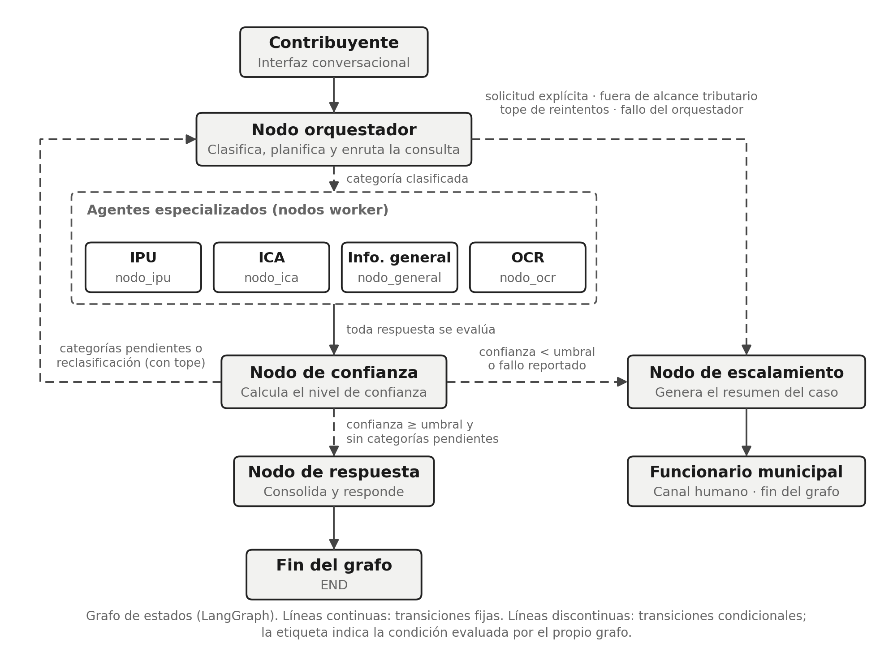
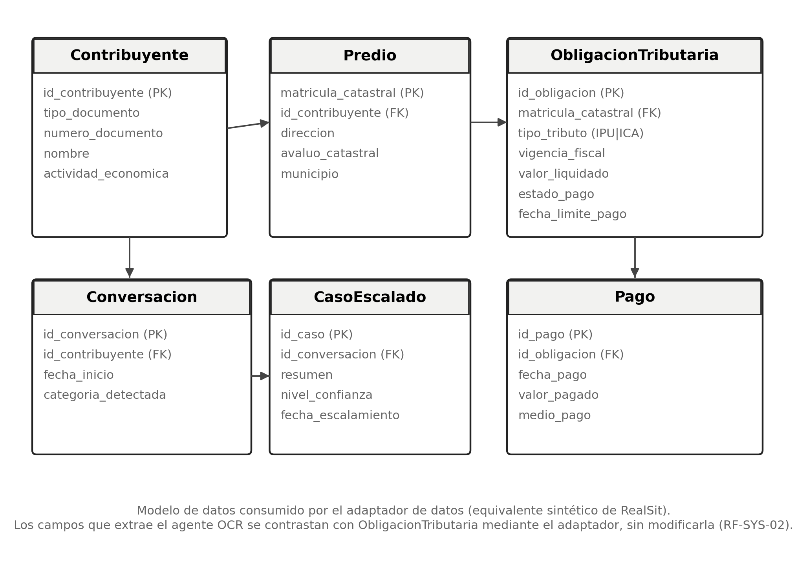
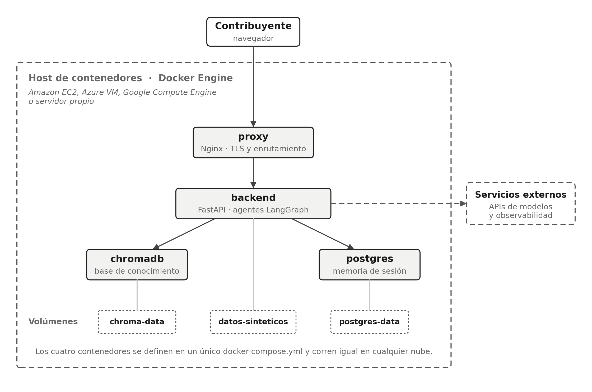

> **Conversión a Markdown de `Arquitectura_OE2_Realtix_FINAL.docx`** (octubre de 2026), para lectura en el chat de desarrollo. El contenido es el del documento oficial; el índice general se reemplazó por las listas de tablas y figuras, sin números de página, y las figuras enlazan a la carpeta `figuras/`. Si hubiera alguna diferencia, rige el `.docx`.

**DOCUMENTO DE ARQUITECTURA**

**Sistema Multiagente de Inteligencia Artificial para el Soporte del Proceso de Facturación de Realtix**

*Fase 2 — Objetivo Específico 2 · Entregable: Documento de arquitectura*

Gilart Pulido Rodolfo Angel · Varón Puerto Dayanna Liceth

Director: MsC. Juan Carlos Barrero Calixto

Universidad Católica de Colombia · Bogotá D.C. · 2026

**Lista de tablas**

- Tabla 1. Nodos del grafo de estados
- Tabla 2. Transiciones del grafo de estados
- Tabla 3. Estado compartido (AgentState)
- Tabla 4. Separación de capas del sistema multiagente de IA
- Tabla 5. Estructura del repositorio de código
- Tabla 6. Colecciones de la base de conocimiento vectorial
- Tabla 7. Contrato del adaptador de datos
- Tabla 8. Endpoints REST del backend
- Tabla 9. Contenedores del sistema multiagente de IA
- Tabla 10. Matriz de trazabilidad — Requerimientos funcionales
- Tabla 11. Matriz de trazabilidad — Requerimientos no funcionales

**Lista de figuras**

- Figura 1. Grafo de estados del sistema multiagente de IA.
- Figura 2. Modelo de datos simplificado del sistema multiagente de IA.
- Figura 3. Topología de despliegue en contenedores.

---

## 1. Introducción

Este documento especifica la arquitectura del sistema multiagente de inteligencia artificial para el soporte del proceso de facturación tributaria municipal de Realtix, en cumplimiento del Objetivo Específico 2 del trabajo de grado. La arquitectura se deriva directamente del Documento de Metas y Requerimientos (Objetivo Específico 1) y satisface la totalidad de los requerimientos funcionales allí definidos, según se verifica en la matriz de trazabilidad de la Tabla 10 y la Tabla 11 (sección 10).

El documento cubre, en orden: la selección del framework de orquestación, el grafo de estados y el flujo de comunicación entre agentes, la interfaz conversacional, el modelo de datos del sistema, la seguridad y el control de acceso, el pipeline de generación aumentada por recuperación (RAG), las APIs internas y los puntos de integración, el empaquetado en contenedores y su despliegue, y la matriz de trazabilidad requerimiento–componente.

## 2. Selección del framework de orquestación

Se selecciona LangGraph como framework de orquestación del sistema multiagente de IA (RF-ORQ-04), por tres razones alineadas con el patrón Supervisor-Worker adoptado: primero, modela el flujo de agentes como un grafo de estados explícito, lo que permite representar de forma directa las transiciones condicionales del sistema multiagente de IA (enrutamiento, evaluación de confianza, escalamiento); segundo, ofrece un mecanismo nativo de checkpoints que persiste el estado de la conversación entre turnos, requisito directo de RF-UI-02; tercero, es el framework de mayor adopción en producción para este patrón, lo que reduce el riesgo técnico del proyecto dado el plazo del MVP.

Como alternativa se consideró CrewAI, descartada porque su abstracción de más alto nivel dificulta el control fino sobre las transiciones condicionales y los checkpoints que exige el mecanismo de escalamiento (RF-ESC-01 a RF-ESC-05).

## 3. Arquitectura general y grafo de estados

Esta sección describe el patrón de orquestación, el grafo de estados con sus nodos y transiciones, el estado compartido, el cálculo del nivel de confianza, la política ante fallos, la separación de capas y la estructura del repositorio.

### 3.1. Patrón de orquestación

El sistema multiagente de IA se estructura como un grafo de estados de LangGraph con ocho nodos: un nodo orquestador (supervisor), cuatro nodos worker especializados, un nodo evaluador de confianza, un nodo de escalamiento y un nodo consolidador de respuesta. El estado se propaga entre nodos como un objeto compartido (ver Tabla 3) y se persiste mediante el checkpointer de LangGraph, indexado por el identificador de conversación. Siguiendo el patrón Supervisor-Worker, el orquestador retoma el control después de cada respuesta parcial evaluada: así atiende en secuencia las consultas que requieren más de un agente especializado (RF-ORQ-03) y reclasifica una consulta mal enrutada, con un número máximo de reintentos que impide bucles infinitos (RF-ORQ-06). Por esta razón el grafo es cíclico, como exige RF-ORQ-04.

### 3.2. Diagrama del grafo de estados

*Figura 1. Grafo de estados del sistema multiagente de IA.*

Fuente: Elaboración propia.

#### 3.2.1. Nodos del grafo

**Tabla 1. Nodos del grafo de estados**

| **Nodo (LangGraph)** | **Tipo**     | **Responsabilidad**                                                                                                                                                               | **RF relacionado**  |
|----------------------|--------------|-----------------------------------------------------------------------------------------------------------------------------------------------------------------------------------|---------------------|
| nodo_orquestador     | Supervisor   | Clasifica el mensaje entrante, planifica las categorías de una consulta multiagente y decide el siguiente nodo a invocar; retoma el control tras cada respuesta parcial evaluada. | RF-ORQ-01/02/03/06  |
| nodo_ipu             | Worker       | Resuelve consultas, estados de cuenta y liquidaciones estimadas de IPU.                                                                                                           | RF-IPU-01..05       |
| nodo_ica             | Worker       | Resuelve consultas y estimaciones de ICA.                                                                                                                                         | RF-ICA-01..04       |
| nodo_general         | Worker       | Resuelve consultas transversales y de uso de la plataforma, e informa cuando una consulta no tributaria está fuera de alcance.                                                    | RF-GEN-01..04       |
| nodo_ocr             | Worker       | Extrae los campos del recibo predial cargado por el contribuyente.                                                                                                                | RF-OCR-01..06       |
| nodo_confianza       | Evaluador    | Calcula el nivel de confianza de cada respuesta parcial y determina si se continúa, se responde o se escala.                                                                      | RF-ESC-01/02        |
| nodo_escalamiento    | Worker       | Genera el resumen estructurado del caso y lo transfiere.                                                                                                                          | RF-ESC-02..05       |
| nodo_respuesta       | Consolidador | Da formato final a la respuesta y la entrega a la interfaz.                                                                                                                       | RF-ORQ-02, RF-UI-02 |

Fuente: Elaboración propia.

#### 3.2.2. Transiciones del grafo

**Tabla 2. Transiciones del grafo de estados**

| **Transición**                                                      | **Tipo**    | **Condición**                                                                                                                                                                                                                                   |
|---------------------------------------------------------------------|-------------|-------------------------------------------------------------------------------------------------------------------------------------------------------------------------------------------------------------------------------------------------|
| nodo_orquestador → nodo_ipu \| nodo_ica \| nodo_general \| nodo_ocr | Condicional | Categoría clasificada por el orquestador. Las consultas no tributarias se dirigen a nodo_general, que informa que el tema no está cubierto (RF-GEN-04).                                                                                         |
| nodo_orquestador → nodo_escalamiento                                | Condicional | Solicitud explícita de atención humana, consulta tributaria fuera del alcance del MVP (RF-SYS-03), número máximo de reclasificaciones alcanzado (RF-ORQ-06) o fallo del modelo del orquestador (RNF-08).                                        |
| nodo_ipu \| nodo_ica \| nodo_general \| nodo_ocr → nodo_confianza   | Fija        | Toda respuesta de un worker pasa por evaluación de confianza.                                                                                                                                                                                   |
| nodo_confianza → nodo_orquestador                                   | Condicional | La respuesta parcial alcanza el umbral y quedan categorías pendientes de una consulta multiagente (RF-ORQ-03), o el worker declaró que la consulta no corresponde a su dominio y no se ha alcanzado el máximo de reclasificaciones (RF-ORQ-06). |
| nodo_confianza → nodo_respuesta                                     | Condicional | Nivel de confianza ≥ umbral configurado y sin categorías pendientes.                                                                                                                                                                            |
| nodo_confianza → nodo_escalamiento                                  | Condicional | Nivel de confianza \< umbral, fallo de un servicio externo reportado por el worker (RNF-08) o consulta tributaria fuera de alcance detectada por el worker (RF-ICA-04).                                                                         |
| nodo_escalamiento → END (canal humano)                              | Fija        | El resumen del caso se entrega al funcionario; el grafo cierra su ejecución.                                                                                                                                                                    |
| nodo_respuesta → END                                                | Fija        | La respuesta consolidada se entrega a la interfaz conversacional.                                                                                                                                                                               |

Fuente: Elaboración propia.

### 3.3. Estado compartido (AgentState)

Todos los nodos leen y escriben sobre un mismo objeto de estado tipado, definido a continuación:

**Tabla 3. Estado compartido (AgentState)**

| **Campo**              | **Tipo**         | **Descripción**                                                                                                                                                          |
|------------------------|------------------|--------------------------------------------------------------------------------------------------------------------------------------------------------------------------|
| messages               | list\[Message\]  | Historial de mensajes de la sesión; se conserva mediante el checkpointer de LangGraph.                                                                                   |
| categoria              | str              | Categoría clasificada por el orquestador (ipu \| ica \| general \| ocr \| fuera_de_alcance).                                                                             |
| datos_extraidos        | dict             | Campos identificados por el worker o por el agente OCR (predio, vigencia, valor, etc.); los extraídos por OCR registran si el contribuyente ya los confirmó (RF-OCR-03). |
| nivel_confianza        | float            | Puntaje de confianza calculado por el nodo de confianza (0.0 a 1.0).                                                                                                     |
| requiere_escalamiento  | bool             | Bandera que activa la transición hacia nodo_escalamiento.                                                                                                                |
| resumen_caso           | str              | Resumen estructurado generado por nodo_escalamiento para el funcionario.                                                                                                 |
| id_conversacion        | str              | Identificador de la sesión, usado como clave del checkpointer.                                                                                                           |
| contribuyente_id       | Optional\[str\]  | Identificador del contribuyente autenticado, resuelto por la capa de control de acceso; vacío en sesiones sin autenticar (RF-AUT-01, RF-AUT-03).                         |
| predios_autorizados    | list\[str\]      | Matrículas catastrales asociadas al contribuyente autenticado: contexto autorizado contra el que se filtran las consultas (sección 6.1, RF-AUT-02).                      |
| categorias_pendientes  | list\[dict\]     | Categorías que faltan por atender en una consulta multiagente, cada una con la parte de la consulta que le corresponde (RF-ORQ-03).                                      |
| intentos_clasificacion | int              | Número de reclasificaciones realizadas en la conversación, comparado contra el máximo configurado (RF-ORQ-06).                                                           |
| respuestas_parciales   | list\[dict\]     | Respuesta de cada worker invocado en el turno, con las fuentes citadas, la similitud de recuperación y la suficiencia declarada (RF-ESC-01, RF-IPU-05).                  |
| motivo_escalamiento    | Optional\[str\]  | Causa del escalamiento (confianza insuficiente, solicitud explícita, fuera de alcance o fallo de servicio), incluida en el resumen del caso (RF-ESC-03).                 |
| documento_adjunto      | Optional\[dict\] | Referencia al archivo cargado para el agente OCR (tipo y ubicación temporal), nunca su contenido (RF-OCR-01, RNF-05).                                                    |

Fuente: Elaboración propia.

Los campos difieren en su ciclo de vida. Se conservan entre turnos mediante el checkpointer los campos messages, id_conversacion, datos_extraidos, resumen_caso e intentos_clasificacion; este último se acumula por conversación, como exige RF-ORQ-06. Los campos contribuyente_id y predios_autorizados los establece la capa de control de acceso en cada solicitud (sección 6.1). Los demás corresponden al turno en curso y se reinician al recibir cada mensaje, de modo que el resultado de un turno anterior, como una bandera de escalamiento, no condicione el siguiente.

### 3.4. Cálculo del nivel de confianza

El nodo de confianza determina si la respuesta de un agente especializado se entrega al contribuyente o se escala a un funcionario. Su puntaje es compuesto y se calcula sobre tres factores verificables (RF-ESC-01):

- Similitud de recuperación: promedio del puntaje de similitud de los fragmentos recuperados de ChromaDB. Un valor bajo indica que la base de conocimiento no contiene material pertinente para la consulta.

- Suficiencia declarada: el agente especializado devuelve, junto con su respuesta, una autoevaluación estructurada que indica si el contexto recuperado le permitió responder por completo, parcialmente o no responder; puede indicar además que necesita una aclaración del contribuyente o que la consulta no corresponde a su dominio.

- Cobertura de alcance: verificación de que la consulta corresponde a los tributos y al municipio cubiertos por el MVP (RF-SYS-03); este factor lo determina el modelo del nodo de confianza (sección 8.3).

El puntaje resultante se normaliza al rango 0.0 a 1.0. Si es inferior al umbral configurado, o si cualquiera de los tres factores indica ausencia de cobertura, el grafo transita hacia el nodo de escalamiento. Se exceptúan las consultas no tributarias, que nodo_general responde informando que el tema no está cubierto (RF-GEN-04) y que no se escalan, para no trasladar al canal humano consultas que este tampoco atiende. El umbral se define como parámetro de configuración y se calibra durante la Fase 4 a partir de los resultados del plan de pruebas, de forma que su ajuste no requiera cambios en el código de los nodos.

Tres reglas complementan el cálculo. Primera: cuando una respuesta se basa solo en datos del adaptador, como un estado de cuenta, no hay fragmentos recuperados; el factor de similitud no aplica y el puntaje se normaliza sobre los otros dos. Segunda: una pregunta de aclaración dirigida al contribuyente es una respuesta válida y no activa el escalamiento, mientras que la declaración de que la consulta no corresponde al dominio del agente la devuelve al orquestador para su reclasificación (Tabla 2). Tercera: en una consulta multiagente basta con que una respuesta parcial quede bajo el umbral para escalar el caso; las partes resueltas con confianza suficiente se entregan al contribuyente junto con la notificación de transferencia y se incluyen en el resumen del caso. La ponderación de los tres factores, al igual que el umbral, es un parámetro de configuración que se calibra en la Fase 4.

### 3.5. Tiempos de espera y degradación ante fallos

Cada invocación a un servicio externo (modelo de lenguaje, base de conocimiento vectorial y adaptador de datos) se realiza bajo un tiempo máximo de espera configurado, con un reintento único ante fallos transitorios. Si el reintento no tiene éxito, el grafo no retorna un error técnico al contribuyente: marca la bandera de escalamiento en el estado compartido y transita hacia el nodo de escalamiento, de modo que la consulta se atienda por el canal humano (RNF-08). La ruta depende del nodo donde ocurre el fallo: si falla el orquestador, el grafo transita directamente al nodo de escalamiento; si falla un worker, este registra el motivo en el estado y el nodo de confianza escala por la transición ya existente; y si falla el registro del caso, el nodo de escalamiento informa igualmente al contribuyente el canal de atención humana disponible. Esta decisión mantiene el sistema multiagente de IA dentro de los tiempos objetivo definidos en RNF-01 y evita respuestas generadas sin contexto suficiente.

### 3.6. Separación de capas

Los nodos del grafo no implementan por sí mismos la lógica tributaria. Cada capa tiene una responsabilidad única y una regla explícita sobre lo que no le corresponde, de modo que la lógica de dominio pueda probarse sin levantar el grafo y el grafo pueda modificarse sin tocar las reglas del negocio:

**Tabla 4. Separación de capas del sistema multiagente de IA**

| **Capa**                   | **Responsabilidad**                                                                                      | **Restricción**                                             |
|----------------------------|----------------------------------------------------------------------------------------------------------|-------------------------------------------------------------|
| Nodos                      | Orquestan el flujo: leen y escriben el estado compartido e invocan servicios                             | No contienen lógica de dominio tributario                   |
| Servicios                  | Concentran la lógica de dominio: liquidación estimada, cálculo de confianza, armado del resumen del caso | No conocen LangGraph ni el estado del grafo                 |
| Adaptador de datos         | Único punto de acceso a la fuente de datos del contribuyente                                             | No contiene reglas tributarias                              |
| Integraciones              | Clientes de servicios externos: modelos de lenguaje, base vectorial y observabilidad                     | No contienen lógica de dominio                              |
| Contenedor de dependencias | Construye una sola vez los servicios y los inyecta en los nodos que los necesitan                        | Es el único punto que conoce las implementaciones concretas |

Fuente: Elaboración propia.

Esta separación es la que permite que el adaptador de datos sea sustituible (RF-SYS-05) y que el modelo de lenguaje de cada agente se cambie por configuración (RF-SYS-04): ambos son detalles que viven en una sola capa y que el resto del sistema multiagente de IA no conoce.

### 3.7. Estructura del repositorio

La organización del código refleja la separación de capas anterior, de forma que la ubicación de un archivo indique su responsabilidad:

**Tabla 5. Estructura del repositorio de código**

| **Ruta**            | **Contenido**                                                                                                                       |
|---------------------|-------------------------------------------------------------------------------------------------------------------------------------|
| src/agents/nodes/   | Un archivo por nodo del grafo, con su prompt asociado; los prompts de los workers exigen lenguaje claro y accesible (RNF-09)        |
| src/agents/graph.py | Definición del grafo: nodos, aristas y transiciones condicionales                                                                   |
| src/agents/state.py | AgentState, el estado compartido que viaja entre nodos                                                                              |
| src/services/       | Lógica de dominio, independiente de LangGraph                                                                                       |
| src/data/adapter.py | RealSitAdapter y su implementación sobre datos sintéticos                                                                           |
| src/integrations/   | Clientes de modelos, base vectorial y observabilidad                                                                                |
| src/api/            | Aplicación FastAPI, endpoints y capa de control de acceso                                                                           |
| src/config.py       | Configuración leída de variables de entorno: claves, cadenas de conexión, modelo por agente y umbrales (RNF-14)                     |
| src/container.py    | Contenedor de dependencias: construye una vez el adaptador, los servicios y las integraciones, y los inyecta en los nodos (Tabla 4) |
| knowledge_base/     | Corpus normativo que alimenta las colecciones vectoriales                                                                           |
| tests/              | Pruebas por dominio, organizadas como el código                                                                                     |

Fuente: Elaboración propia.

## 4. Interfaz conversacional

La interfaz conversacional se implementa como un widget embebible en la Oficina Virtual Tributaria (RF-UI-01), distribuido como un paquete JavaScript autónomo que se inserta en la página del portal mediante una etiqueta de script y se monta en un contenedor aislado, de forma que sus estilos no interfieran con los del portal anfitrión.

- Comunicación con el backend mediante los endpoints REST descritos en la Tabla 8 (sección 8.2), enviando en cada solicitud el identificador de conversación que actúa como clave del checkpointer (RF-UI-02).

- Indicador visible del interlocutor actual, que distingue si el contribuyente está siendo atendido por un agente automático o por un funcionario humano tras un escalamiento (RF-UI-03).

- Control de carga de archivos (imagen o PDF) que envía el documento al endpoint de procesamiento del agente OCR (RF-UI-04).

- Mensaje de fuera de horario cuando el backend responde que la consulta se realiza fuera de la franja de atención definida (RNF-07).

## 5. Modelo de datos del sistema

El modelo de datos representa el contrato de información que el adaptador de datos expone a los agentes, independientemente de si la fuente subyacente es el ambiente sintético de desarrollo o, en una integración futura, el sistema RealSit real (ver Tabla 7, sección 8.1).

### 5.1. Entidades del modelo

La Figura 2 presenta las seis entidades del modelo y sus relaciones.

*Figura 2. Modelo de datos simplificado del sistema multiagente de IA.*

Fuente: Elaboración propia.

Las entidades Contribuyente, Predio, ObligacionTributaria y Pago replican el dominio de información que expondría RealSit para el municipio piloto (Bogotá D.C.). Las entidades Conversacion y CasoEscalado son propias del sistema multiagente de IA y no dependen de RealSit: registran, respectivamente, la sesión conversacional y los casos transferidos al funcionario (RF-ESC-03).

Dos precisiones de modelado aplican al MVP. La obligación de ICA grava la actividad económica y no la propiedad; como el modelo asocia toda obligación a un predio, cada contribuyente con actividad económica registra una sola obligación de ICA por vigencia, asociada al predio donde ejerce la actividad. Además, la entidad Conversacion se materializa en el conjunto sintético cuando la conversación genera un caso escalado, mientras que el historial completo de cada sesión reside en el checkpointer (sección 8.4).

### 5.2. Plantilla sintética del recibo predial

La plantilla sintética del recibo de pago del Impuesto Predial Unificado, sobre la cual opera el agente OCR durante el desarrollo y la evaluación (RF-OCR-06), reproduce la estructura típica de los recibos de las administraciones tributarias municipales colombianas. Cada recibo contiene los siguientes campos:

- Matrícula catastral o identificación del predio.

- Nombre del propietario y dirección del predio.

- Vigencia fiscal.

- Avalúo catastral.

- Tarifa aplicada, expresada en por mil.

- Valor liquidado.

- Descuento por pronto pago.

- Fecha límite de pago.

De estos campos, el agente OCR extrae los seis que exige RF-OCR-02: matrícula catastral, vigencia fiscal, avalúo catastral, valor liquidado, descuentos aplicables y fecha límite de pago. Los recibos se generan a partir del conjunto de datos sintéticos, de modo que cada imagen tiene valores de referencia conocidos contra los cuales se mide la exactitud de la extracción en la Fase 4. Todos llevan la leyenda «Documento sintético sin validez tributaria». Para verificar el rechazo de documentos ilegibles o que no corresponden a un recibo predial (RF-OCR-04) se producen variantes degradadas (desenfoque, baja resolución y recortes) y documentos de otro tipo. Los formatos admitidos son JPG, PNG y PDF, y el tamaño máximo por archivo es un parámetro de configuración (RF-OCR-01, RNF-14).

## 6. Seguridad y control de acceso

Esta sección describe cómo el sistema multiagente de IA verifica la identidad del contribuyente y restringe el acceso a sus datos, cómo controla el horario de atención y cómo trata y registra la información.

### 6.1. Autenticación y autorización del contribuyente

El sistema multiagente de IA no implementa un mecanismo de autenticación propio: opera sobre la sesión ya autenticada del contribuyente en la Oficina Virtual Tributaria (RF-AUT-01). El widget transmite al backend el token de sesión del portal, y una capa de control de acceso previa al grafo resuelve, a partir de ese token, el identificador del contribuyente y obtiene el conjunto de predios asociados a él mediante el método get_predios_contribuyente del adaptador de datos (Tabla 7).

Dicho conjunto de predios se inyecta en el estado compartido como contexto autorizado (campos contribuyente_id y predios_autorizados de la Tabla 3). El adaptador de datos filtra toda consulta contra ese contexto, de modo que una solicitud sobre una matrícula catastral que no pertenece al contribuyente autenticado se rechaza aunque la matrícula sea válida (RF-AUT-02); el rechazo se comunica con un mensaje explícito que no revela información del predio consultado y no se escala al canal humano. Esta decisión es necesaria porque las matrículas catastrales son información de acceso público, y sin este filtro cualquier persona podría consultar las obligaciones tributarias de un tercero, en contravención de la Ley 1581 de 2012 (RNF-03).

Las consultas de carácter conceptual o normativo, que no involucran datos de un contribuyente identificable, se atienden sin requerir sesión autenticada (RF-AUT-03). El agente orquestador distingue ambos casos en el momento de la clasificación: si la categoría resuelta requiere datos personales y no existe sesión válida, el sistema multiagente de IA informa al contribuyente que debe iniciar sesión para continuar (RF-AUT-04).

### 6.2. Control del horario de atención

El backend valida el horario de cada solicitud antes de invocar el grafo. Fuera de la franja de 8:00 a. m. a 5:00 p. m. en días hábiles (RNF-06), no se ejecutan los agentes y se retorna una respuesta informativa que el widget presenta al contribuyente indicando el horario de atención (RNF-07). Esta decisión mantiene la coherencia con la disponibilidad del canal humano al que el sistema multiagente de IA escala los casos no resueltos, evitando que un contribuyente sea escalado a un funcionario fuera de servicio.

### 6.3. Tratamiento y registro de datos

- Durante el desarrollo y la evaluación, el adaptador de datos apunta exclusivamente al conjunto sintético; no existe ruta de acceso a datos reales de contribuyentes (RNF-04).

- Las trazas enviadas a LangSmith excluyen los identificadores personales del contribuyente, registrando en su lugar el identificador de conversación (RNF-05).

- La comunicación entre el widget y el backend se realiza sobre HTTPS; la terminación TLS ocurre en el contenedor proxy (sección 9.2).

## 7. Pipeline RAG y organización de la base de conocimiento

La base de conocimiento vectorial se organiza en colecciones separadas por dominio, de forma que cada agente especializado consulte únicamente la colección correspondiente a su alcance normativo, evitando recuperación cruzada de contenido irrelevante:

**Tabla 6. Colecciones de la base de conocimiento vectorial**

| **Colección (ChromaDB)** | **Contenido**                                                                                                                                                                                    | **Agente consumidor** | **Actualización**     |
|--------------------------|--------------------------------------------------------------------------------------------------------------------------------------------------------------------------------------------------|-----------------------|-----------------------|
| normativa_ipu            | Ley 44 de 1990 con la modificación del artículo 23 de la Ley 1450 de 2011, Ley 1995 de 2019 y normativa distrital de IPU (Decretos 352 de 2002 y 807 de 1993, y acuerdos del Concejo de Bogotá). | nodo_ipu              | Manual, vía RF-OBS-04 |
| normativa_ica            | Ley 14 de 1983 y normativa distrital de ICA (Decretos 352 de 2002 y 807 de 1993, y acuerdos del Concejo de Bogotá).                                                                              | nodo_ica              | Manual, vía RF-OBS-04 |
| normativa_datos          | Ley 1581 de 2012 y decretos reglamentarios.                                                                                                                                                      | nodo_general          | Manual, vía RF-OBS-04 |
| plataforma_general       | Manuales de uso de la Oficina Virtual Tributaria y glosario de términos.                                                                                                                         | nodo_general          | Manual, vía RF-OBS-04 |

Fuente: Elaboración propia.

El pipeline de ingesta comprende cuatro pasos que se ejecutan una sola vez por documento: (1) carga de los documentos fuente, (2) segmentación en fragmentos de 400 a 800 tokens con solapamiento de 50 a 100 tokens, (3) generación de embeddings con el modelo text-embedding-3-large, y (4) almacenamiento en ChromaDB con índice HNSW. La actualización de cualquier colección se realiza mediante reingesta, sin requerir cambios en el código de los agentes (RF-OBS-04).

La recuperación, que se ejecuta en cada consulta, es híbrida: combina una búsqueda vectorial por similitud semántica con una búsqueda léxica por coincidencia de términos, ambas filtradas por la colección que corresponde al agente. Los resultados de los dos canales se fusionan y se seleccionan los mejores fragmentos para el prompt. La razón de no usar únicamente búsqueda vectorial es que el dominio tributario contiene identificadores que deben coincidir literalmente, como «Ley 44 de 1990» o «artículo 354»: la búsqueda semántica puede pasarlos por alto, mientras que la léxica los recupera con exactitud. El puntaje de similitud de los fragmentos recuperados alimenta además el primer factor del nodo de confianza (sección 3.4).

## 8. APIs internas y puntos de integración

Esta sección define el contrato del adaptador de datos, los endpoints del backend, la integración con los modelos de lenguaje y con la herramienta de observabilidad, y la persistencia del estado conversacional.

### 8.1. Contrato del adaptador de datos

Los agentes no acceden directamente a la base de datos; lo hacen a través de un adaptador con la siguiente interfaz. Todas las consultas se filtran contra el contexto autorizado descrito en la sección 6.1. Esta separación permite sustituir la implementación sintética por una integración real con RealSit sin modificar los nodos del grafo (RF-SYS-05):

**Tabla 7. Contrato del adaptador de datos**

| **Método**                | **Parámetros → Retorno**                                                           | **Usado por**                                                 |
|---------------------------|------------------------------------------------------------------------------------|---------------------------------------------------------------|
| get_predios_contribuyente | contribuyente_id: str → list\[Predio\]                                             | Capa de control de acceso (sección 6.1); nodo_ipu (RF-IPU-02) |
| get_estado_cuenta         | predio_id: str, contribuyente_id: str → EstadoCuenta                               | nodo_ipu (RF-IPU-02)                                          |
| get_historial_pagos       | predio_id: str, contribuyente_id: str → list\[Pago\]                               | nodo_ipu (RF-IPU-02)                                          |
| get_avaluo_catastral      | predio_id: str, contribuyente_id: str → Avaluo                                     | nodo_ipu (RF-IPU-03)                                          |
| get_tarifa_ica            | actividad_economica: str → Tarifa                                                  | nodo_ica (RF-ICA-02)                                          |
| get_obligaciones_vigentes | predio_id: str, contribuyente_id: str, tributo: str → list\[ObligacionTributaria\] | nodo_ipu, nodo_ica                                            |
| registrar_caso_escalado   | resumen: CasoEscalado → Ack                                                        | nodo_escalamiento (RF-ESC-03)                                 |

Fuente: Elaboración propia.

Los métodos que exponen datos de un predio reciben el identificador del contribuyente autenticado y rechazan la consulta si el predio no le pertenece (RF-AUT-02). Se consideran obligaciones vigentes las pendientes de pago, en estado pendiente o vencido, de cualquier vigencia fiscal. El método get_predios_contribuyente permite construir el contexto autorizado de la sección 6.1 y resolver las consultas en las que el contribuyente se identifica con su cédula o NIT (RF-IPU-02).

### 8.2. Endpoints REST del backend

El backend (FastAPI) expone los siguientes endpoints internos, consumidos por la interfaz conversacional y por el mecanismo de escalamiento:

**Tabla 8. Endpoints REST del backend**

| **Método** | **Ruta**                                  | **Descripción**                                                                                                                                   |
|------------|-------------------------------------------|---------------------------------------------------------------------------------------------------------------------------------------------------|
| POST       | /api/v1/chat/mensaje                      | Recibe un mensaje del contribuyente e invoca el grafo de agentes; devuelve la respuesta consolidada.                                              |
| POST       | /api/v1/chat/documento                    | Recibe un archivo (imagen o PDF) para su procesamiento por el nodo_ocr.                                                                           |
| GET        | /api/v1/predios/{predio_id}/estado-cuenta | Expone el adaptador de datos para consulta de estado de cuenta.                                                                                   |
| GET        | /api/v1/predios/{predio_id}/pagos         | Expone el historial de pagos del predio.                                                                                                          |
| POST       | /api/v1/escalamiento                      | Registra un caso escalado y lo pone a disposición del funcionario.                                                                                |
| GET        | /api/v1/admin/metricas                    | Expone las métricas de enrutamiento y tiempo de respuesta (RF-OBS-02/03).                                                                         |
| GET        | /health                                   | Verificación de estado del servicio y de la inicialización de los agentes; la usa el contenedor para comprobar que el despliegue quedó operativo. |

Fuente: Elaboración propia.

### 8.3. Integración con el modelo de lenguaje y con observabilidad

- nodo_orquestador y nodo_confianza invocan Claude Sonnet 4.6 vía la API de Anthropic, dado que la tarea de clasificación y evaluación exige mayor capacidad de razonamiento (RF-ORQ-05).

- nodo_ipu, nodo_ica, nodo_general y nodo_ocr invocan Claude Haiku 4.5, optimizando el costo por consulta en las tareas de ejecución (RF-OCR-05).

- Toda invocación a un modelo se realiza a través de una capa de abstracción de proveedor, de forma que el modelo configurado por agente pueda sustituirse sin cambios estructurales (RF-SYS-04, RNF-10).

- Cada ejecución del grafo se traza en LangSmith, registrando el nodo invocado, la herramienta utilizada y el tiempo de cada paso (RF-OBS-01).

### 8.4. Persistencia del estado conversacional

El checkpointer de LangGraph se respalda sobre PostgreSQL, desplegado como un contenedor propio con su volumen persistente (sección 9.1), utilizando el identificador de conversación como clave. Esta elección, frente a un checkpointer en memoria, permite que el contexto de la sesión sobreviva a reinicios del backend y a despliegues de nuevas versiones (RF-UI-02), y hace posible reconstruir la conversación completa al momento de generar el resumen de un caso escalado (RF-ESC-03).

## 9. Empaquetado y despliegue

Esta sección describe la contenerización del sistema multiagente de IA, su topología de despliegue y el alcance de su portabilidad entre proveedores de nube.

### 9.1. Contenerización

El sistema multiagente de IA se empaqueta en imágenes de contenedor conforme al estándar OCI y se orquesta con Docker Compose (RNF-12, RNF-13). Esta decisión responde a un requisito de portabilidad: el despliegue del MVP se realiza sobre Amazon Web Services por ser la nube en la que opera RealSit, pero el sistema multiagente de IA no queda atado a ese proveedor y puede llevarse a otra nube o a un servidor propio sin modificar el código de la aplicación.

**Tabla 9. Contenedores del sistema multiagente de IA**

| **Contenedor** | **Responsabilidad**                            | **Imagen base**                   | **Volumen**      |
|----------------|------------------------------------------------|-----------------------------------|------------------|
| proxy          | Terminación TLS y enrutamiento al backend      | Nginx                             | —                |
| backend        | API REST, control de acceso y grafo de agentes | Python 3.12 · FastAPI · LangGraph | datos-sinteticos |
| chromadb       | Base de conocimiento vectorial                 | chromadb/chroma                   | chroma-data      |
| postgres       | Memoria de sesión del checkpointer             | postgres:16                       | postgres-data    |

Fuente: Elaboración propia.

Toda la configuración dependiente del entorno (claves de las APIs de modelos, cadenas de conexión a ChromaDB y PostgreSQL, y el umbral del nodo de confianza) se inyecta mediante variables de entorno, sin valores fijos en el código ni en las imágenes (RNF-14). Los datos de la base de conocimiento, la memoria de sesión y el conjunto sintético residen en volúmenes externos a los contenedores, de modo que sobreviven a su reinicio o sustitución (RNF-15).

### 9.2. Topología de despliegue

*Figura 3. Topología de despliegue en contenedores.*

Fuente: Elaboración propia.

El contenedor proxy es el único expuesto al exterior: recibe el tráfico del widget sobre HTTPS y lo reenvía al backend por la red interna de contenedores, de modo que ni ChromaDB ni PostgreSQL quedan accesibles desde fuera del host. El escalamiento ante picos de consulta se resuelve replicando el contenedor de backend, que es el único componente sin estado propio (RNF-02).

### 9.3. Alcance de la portabilidad

La contenerización elimina la dependencia del proveedor para el cómputo y el almacenamiento de datos, que son la mayor parte del sistema multiagente de IA. Subsisten dos dependencias externas que no dependen de la nube elegida sino de servicios de terceros: las APIs de los modelos de lenguaje y la herramienta de observabilidad, ambas consumidas por red desde el contenedor de backend. En el despliegue sobre AWS se emplean adicionalmente Route 53 y AWS Certificate Manager para el dominio y el certificado TLS; al migrar a otro proveedor, esa función la cubre el servicio equivalente de la nube destino o un certificado gestionado por el propio contenedor proxy. Como la terminación TLS ocurre en el contenedor proxy, el certificado de AWS Certificate Manager debe emitirse como certificado público exportable, modalidad que tiene costo por emisión y renovación; los certificados no exportables solo pueden asociarse a servicios integrados de AWS, como un balanceador de carga.

## 10. Matriz de trazabilidad requerimiento–componente

Esta sección verifica que cada requerimiento del Objetivo Específico 1 está cubierto por al menos un componente de la arquitectura, primero para los requerimientos funcionales y luego para los no funcionales.

### 10.1. Requerimientos funcionales

La siguiente matriz verifica que cada grupo de requerimientos funcionales del Objetivo Específico 1 está cubierto por al menos un componente de esta arquitectura, dando cumplimiento al KPI del Objetivo Específico 2 (100% de componentes que satisfacen los requerimientos aprobados). La columna de referencia indica, para cada grupo, la tabla o la sección donde se define el componente correspondiente:

**Tabla 10. Matriz de trazabilidad — Requerimientos funcionales**

| **Grupo de requerimientos** | **Componente de arquitectura**                                                  | **Referencia**                    |
|-----------------------------|---------------------------------------------------------------------------------|-----------------------------------|
| RF-SYS-01..05               | Grafo de estados completo (LangGraph) y adaptador de datos                      | Figura 1; Tabla 7                 |
| RF-AUT-01..04               | Capa de control de acceso del backend + contexto autenticado en AgentState      | Sección 6.1; Tabla 3; Tabla 7     |
| RF-ORQ-01..06               | nodo_orquestador y transiciones de retorno al orquestador                       | Tabla 1 y 2                       |
| RF-IPU-01..05               | nodo_ipu + colección normativa_ipu + adaptador de datos                         | Tabla 1 y 6; Tabla 7              |
| RF-ICA-01..04               | nodo_ica + colección normativa_ica + adaptador de datos                         | Tabla 1 y 6; Tabla 7              |
| RF-GEN-01..04               | nodo_general + colecciones normativa_datos y plataforma_general                 | Tabla 1 y 6                       |
| RF-OCR-01..06               | nodo_ocr + modelo de visión (Claude Haiku 4.5) + plantilla sintética del recibo | Tabla 1; Sección 5.2; Sección 8.3 |
| RF-ESC-01..05               | nodo_confianza y nodo_escalamiento                                              | Tabla 1 y 2; Sección 3.4          |
| RF-UI-01..04                | Widget conversacional + endpoint /chat/mensaje                                  | Sección 4; Tabla 8                |
| RF-OBS-01..05               | Integración con LangSmith + endpoint /admin/metricas                            | Tabla 8; Sección 8.3              |

Fuente: Elaboración propia.

### 10.2. Requerimientos no funcionales

De igual forma, cada requerimiento no funcional se asocia al componente o a la decisión de arquitectura que lo materializa:

**Tabla 11. Matriz de trazabilidad — Requerimientos no funcionales**

| **Requerimiento** | **Componente o decisión de arquitectura**                            | **Referencia**             |
|-------------------|----------------------------------------------------------------------|----------------------------|
| RNF-01            | Selección de modelo por agente y recuperación filtrada por colección | Sección 7; Sección 8.3     |
| RNF-02            | Replicación del contenedor de backend                                | Sección 9.2                |
| RNF-03, RNF-04    | Capa de control de acceso y adaptador con datos sintéticos           | Sección 6.1 y 6.3; Tabla 7 |
| RNF-05            | Trazas en LangSmith y registro de conversaciones                     | Sección 6.3; Sección 8.3   |
| RNF-06, RNF-07    | Control de horario de atención en el backend                         | Sección 6.2                |
| RNF-08            | Política de tiempos de espera y degradación hacia escalamiento       | Sección 3.5; Tabla 2       |
| RNF-09            | Prompts de sistema de los agentes especializados                     | Tabla 5                    |
| RNF-10            | Capa de abstracción de proveedor de modelo                           | Sección 8.3                |
| RNF-11            | Repositorio Git del proyecto (entregable del trabajo de grado)       | —                          |
| RNF-12, RNF-13    | Imágenes OCI orquestadas con Docker Compose                          | Sección 9.1; Tabla 9       |
| RNF-14            | Configuración por variables de entorno                               | Sección 9.1                |
| RNF-15            | Volúmenes persistentes fuera de los contenedores                     | Sección 9.1 y 9.2          |
| RNF-16            | Plan de pruebas de la Fase 4 sobre el ambiente desplegado            | Sección 8.3                |

Fuente: Elaboración propia.

## 11. Aprobación

Este documento constituye el entregable de la Fase 2 del proyecto (documento de arquitectura del sistema multiagente de IA) y da cumplimiento al Objetivo Específico 2 del trabajo de grado. Con su elaboración queda listo el proyecto para iniciar la Fase 3 (Desarrollo del sistema).

Elaborado por: Rodolfo Angel Gilart Pulido, Dayanna Liceth Varón Puerto

Director: MsC. Juan Carlos Barrero Calixto
