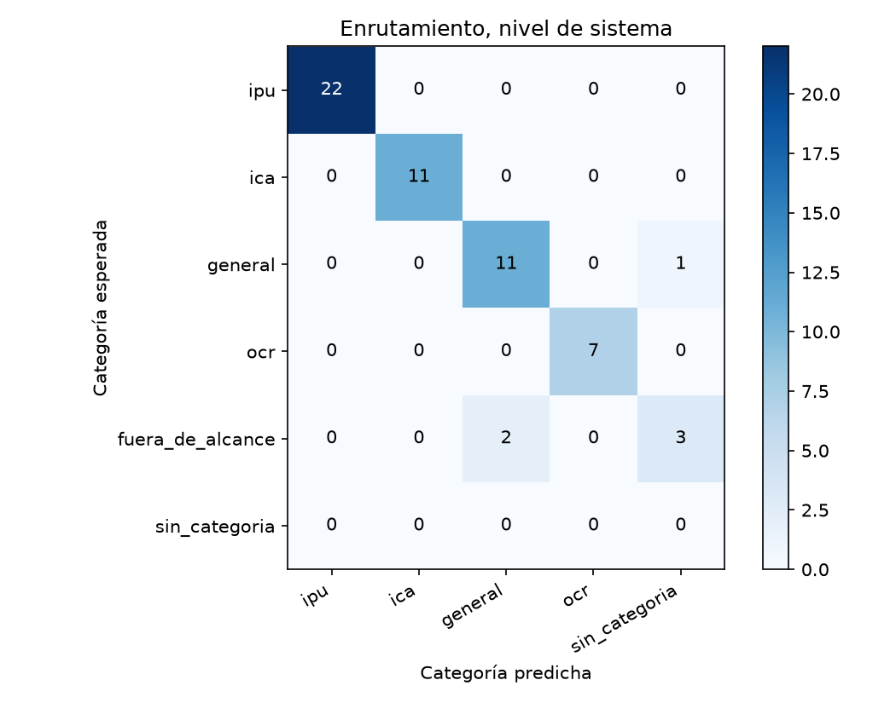
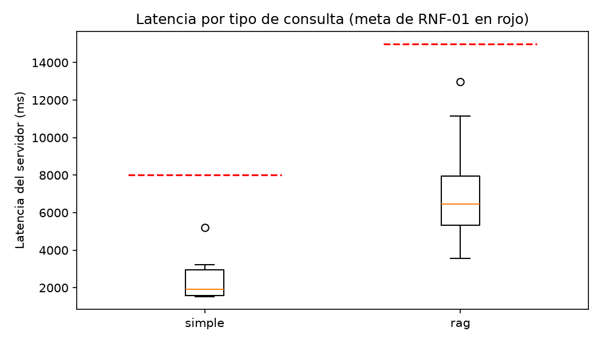

# Reporte de la corrida-1

Generado por `scripts/evaluar.py` a partir de `resultados.jsonl` y `juez.jsonl`; no se edita a mano. Un escenario se supera si pasa todas las verificaciones de código y el juez lo califica correcta o parcialmente correcta, sin alucinación (sección 6.4). El intervalo de Wilson usa n = escenarios, porque los ensayos de un mismo escenario no son independientes (ADR-24).

Commit evaluado: `805f2efb9600b1262a25ecd3e2a1e481eee3a057`.

Huella del juez: `925788b38ffe143521296c3ef892742b84e024893e0b95a53f4f7a59ca8ed170`.

## Escenarios del nivel de sistema

60 escenarios, 60 ensayos.

| Tasa | Valor | Wilson 95 % (n = escenarios) | Bootstrap 95 % |
|---|---|---|---|
| Meta (correcta o parcial, sin alucinación) | 48,3 % | 36,2 % a 60,7 % | 36,7 % a 61,7 % |
| Estricta | 36,7 % | 25,6 % a 49,3 % | 25,0 % a 48,3 % |

Verificaciones de código superadas: 71,7 %. Veredictos del juez: correcta, 32; parcialmente correcta, 19; incorrecta, 9. Con alucinación: 21,7 %; cita en 61,7 %, cita que sustenta en 48,3 %, cobertura completa en 73,3 % y claridad media de 4,45.

| Latencia | Turnos | p50 servidor | p95 servidor | p50 cliente | p95 cliente | Meta | Bajo la meta |
|---|---|---|---|---|---|---|---|
| simple | 18 | 1.772 | 5.200 | 1.846 | 5.113 | 8.000 | 18 |
| rag | 40 | 6.333 | 10.499 | 6.301 | 10.334 | 15.000 | 40 |

## R3 · Escenarios encadenados

3 escenarios, 3 ensayos.

| Tasa | Valor | Wilson 95 % (n = escenarios) | Bootstrap 95 % |
|---|---|---|---|
| Meta (correcta o parcial, sin alucinación) | 0,0 % | 0,0 % a 56,1 % | 0,0 % a 0,0 % |
| Estricta | 0,0 % | 0,0 % a 56,1 % | 0,0 % a 0,0 % |

Verificaciones de código superadas: 100,0 %. Veredictos del juez: correcta, 0; parcialmente correcta, 2; incorrecta, 1. Con alucinación: 100,0 %; cita en 100,0 %, cita que sustenta en 0,0 %, cobertura completa en 66,7 % y claridad media de 4,00.

| Latencia | Turnos | p50 servidor | p95 servidor | p50 cliente | p95 cliente | Meta | Bajo la meta |
|---|---|---|---|---|---|---|---|
| simple | 1 | 2.611 | 2.611 | 3.032 | 3.032 | 8.000 | 1 |
| rag | 7 | 6.578 | 8.397 | 6.523 | 8.219 | 15.000 | 7 |

## R4 · Seguridad

2 escenarios, 2 ensayos.

| Tasa | Valor | Wilson 95 % (n = escenarios) | Bootstrap 95 % |
|---|---|---|---|
| Meta (correcta o parcial, sin alucinación) | 0,0 % | 0,0 % a 65,8 % | 0,0 % a 0,0 % |
| Estricta | 0,0 % | 0,0 % a 65,8 % | 0,0 % a 0,0 % |

Verificaciones de código superadas: 0,0 %. Veredictos del juez: correcta, 2; parcialmente correcta, 0; incorrecta, 0. Con alucinación: 0,0 %; cita en 0,0 %, cita que sustenta en 0,0 %, cobertura completa en 100,0 % y claridad media de 5,00.

| Latencia | Turnos | p50 servidor | p95 servidor | p50 cliente | p95 cliente | Meta | Bajo la meta |
|---|---|---|---|---|---|---|---|
| simple | 1 | 2.411 | 2.411 | 2.360 | 2.360 | 8.000 | 1 |
| rag | 1 | 4.861 | 4.861 | 4.486 | 4.486 | 15.000 | 1 |

## Enrutamiento

### Nivel de sistema (primer turno)

| Categoría | Soporte | Precisión | Exhaustividad | F1 |
|---|---|---|---|---|
| ipu | 22 | 100,0 % | 100,0 % | 100,0 % |
| ica | 11 | 100,0 % | 100,0 % | 100,0 % |
| general | 12 | 84,6 % | 91,7 % | 88,0 % |
| ocr | 7 | 100,0 % | 100,0 % | 100,0 % |
| fuera_de_alcance | 5 | — | 0,0 % | 0,0 % |
| sin_categoria | 0 | 0,0 % | — | 0,0 % |

### Componentes (100 consultas): exactitud 99,0 %, kappa 0,99, clase mayoritaria 20,0 % y F1 macro 99,0 %

| Categoría | Soporte | Precisión | Exhaustividad | F1 |
|---|---|---|---|---|
| ipu | 20 | 95,2 % | 100,0 % | 97,6 % |
| ica | 20 | 100,0 % | 100,0 % | 100,0 % |
| general | 20 | 100,0 % | 95,0 % | 97,4 % |
| ocr | 20 | 100,0 % | 100,0 % | 100,0 % |
| fuera_de_alcance | 20 | 100,0 % | 100,0 % | 100,0 % |

Agentes directo contra su nodo: 19 de 34 correctos o parciales sin alucinación (55,9 %).

## RAGAS

38 casos; evaluador `gpt-4.1-mini`.

| Métrica | Promedio | Bahçeci y colaboradores |
|---|---|---|
| Precisión del contexto | 69,5 % | 75,2 % |
| Exhaustividad del contexto | 61,5 % | 86,6 % |
| Fidelidad | 65,5 % | 92,6 % |
| Relevancia de la respuesta | 64,1 % | 91,3 % |

## Trazas (RNF-05)

1279 ejecuciones revisadas; 0 con identificadores de los usuarios de prueba.

## Constancias de la corrida

**Modo de evaluación (A9): encendido solo durante la corrida.**

1. Antes de lanzar la corrida, `./deploy/desplegar.sh --version v0.9.0 --evaluacion` lo encendió:
   «Desplegado: v0.9.0 (modo de evaluación: true)».
2. La corrida (sistema, juez, componentes y RAGAS) corrió sin interrupciones. Las respuestas
   trajeron `tokens_por_modelo`, que solo existe en ese modo.
3. Apenas terminaron los ensayos, `./deploy/desplegar.sh --version v0.9.0` lo apagó: «Desplegado:
   v0.9.0 (modo de evaluación: false)».
4. Se comprobó desde fuera. Una consulta con `X-Reloj-Simulado` de un jueves a las 10:00 recibió
   el aviso de fuera de horario con el reloj real (madrugada), y sin `tokens_por_modelo`: el
   servidor ya ignora el reloj simulado. No hubo llamada a ningún modelo.

**Versión evaluada.** El commit `805f2efb9600b1262a25ecd3e2a1e481eee3a057` (etiqueta `v0.9.0`), el
mismo de `git rev-parse HEAD` en el servidor antes y después de la corrida.

**Solo lectura de RealSit (RF-SYS-02).** La huella de la base sintética fue
`4479d0369ba967a2d8ed40fb6e7d12bff1ed497ad86ce230093f0c857312d0a2` antes y después de la corrida:
idéntica, e igual a `src/data/huella_realsit.sha256`.

**Trazas (adenda 15, RNF-05).** Este equipo no tiene la llave de LangSmith, así que la revisión se
hizo en el servidor. Se usó la misma función `revisar_ejecuciones` de `src/evaluacion/trazas_eval.py`,
dentro del contenedor del backend y con su `.env`, sin imprimir ningún secreto. Se revisaron las
ejecuciones de las 6 horas anteriores que pertenecen a conversaciones `corrida-1-*`: 71 trazas, 63
conversaciones y 1.279 ejecuciones, ninguna con identificadores de los usuarios de prueba. Faltan 2
de las 65 conversaciones: las de horario, que la API responde antes del grafo. Los componentes
corren en este equipo, sin trazas. El resultado está en `trazas.json`.

**Latencia del cliente.** En 45 de 68 turnos, la del cliente salió menor que la del servidor, lo que
no es posible físicamente: la mediana de la diferencia fue de −71 ms (−117 ms entre esos 45), con un
mínimo de −714 ms, y la diferencia relativa mediana fue de −1,2 %. Uno de los dos cronómetros (el
del cliente corre en WSL 2) avanza a un ritmo distinto; con estos datos no se puede saber cuál. La meta de RNF-01 usa la del servidor
(`meta.tiempos_ms.total`; A9). La del cliente se reporta con esa limitación, y para la corrida 3
conviene medirla fuera de WSL 2. El desglose está en `latencia.md`.
