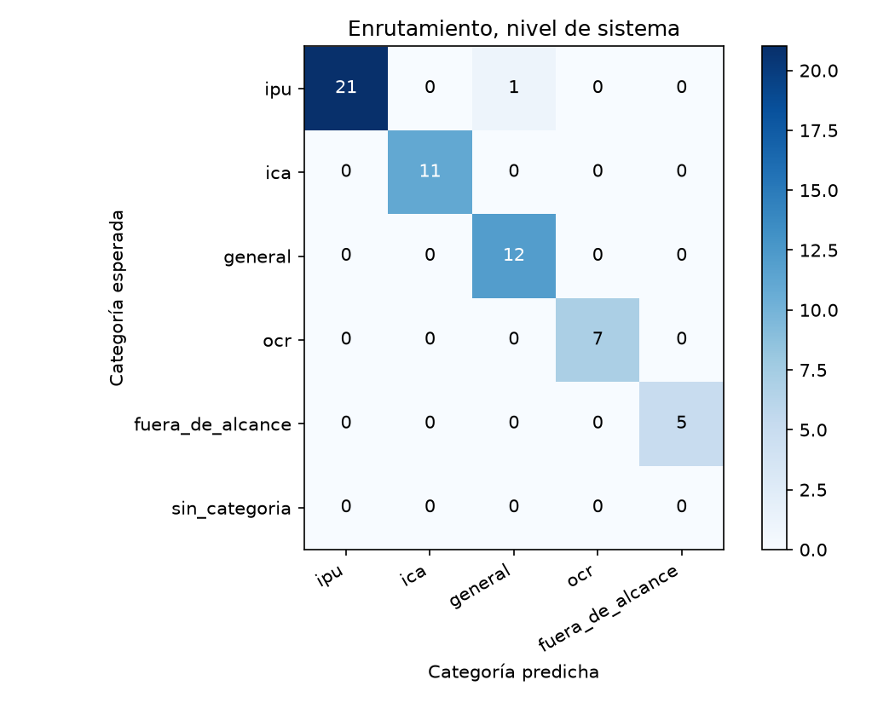
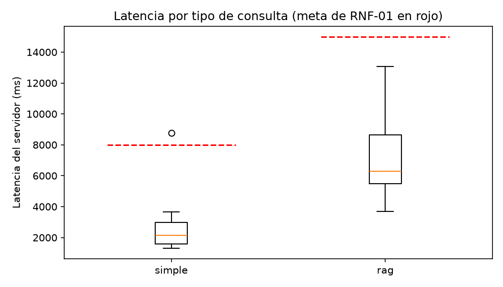

# Reporte de la corrida-2

Generado por `scripts/evaluar.py` a partir de `resultados.jsonl` y `juez.jsonl`; no se edita a mano. Un escenario se supera si pasa todas las verificaciones de código y el juez lo califica correcta o parcialmente correcta, sin alucinación (sección 6.4). El intervalo de Wilson usa n = escenarios, porque los ensayos de un mismo escenario no son independientes (ADR-24).

Commit evaluado: `4e94e7a5ce5fecc75b5f3eaf0924e215db51df50`.

Huella del juez: `afecd5c1b4f62d52fc605ac6b350363cddee4604ae704f30247703146aa39805`.

## Escenarios del nivel de sistema

60 escenarios, 60 ensayos.

| Tasa | Valor | Wilson 95 % (n = escenarios) | Bootstrap 95 % |
|---|---|---|---|
| Meta (correcta o parcial, sin alucinación) | 88,3 % | 77,8 % a 94,2 % | 80,0 % a 95,0 % |
| Estricta | 75,0 % | 62,8 % a 84,2 % | 63,3 % a 85,0 % |

Verificaciones de código superadas: 91,7 %. Veredictos del juez: correcta, 47; parcialmente correcta, 10; incorrecta, 3. Con alucinación: 3,3 %; cita en 58,3 %, cita que sustenta en 58,3 %, cobertura completa en 80,0 % y claridad media de 4,67.

| Latencia | Turnos | p50 servidor | p95 servidor | p50 cliente | p95 cliente | Meta | Bajo la meta |
|---|---|---|---|---|---|---|---|
| simple | 19 | 2.162 | 8.782 | 2.288 | 8.241 | 8.000 | 18 |
| rag | 39 | 6.373 | 12.372 | 6.044 | 11.544 | 15.000 | 39 |

## R3 · Escenarios encadenados

3 escenarios, 3 ensayos.

| Tasa | Valor | Wilson 95 % (n = escenarios) | Bootstrap 95 % |
|---|---|---|---|
| Meta (correcta o parcial, sin alucinación) | 100,0 % | 43,9 % a 100,0 % | 100,0 % a 100,0 % |
| Estricta | 66,7 % | 20,8 % a 93,9 % | 0,0 % a 100,0 % |

Verificaciones de código superadas: 100,0 %. Veredictos del juez: correcta, 2; parcialmente correcta, 1; incorrecta, 0. Con alucinación: 0,0 %; cita en 100,0 %, cita que sustenta en 100,0 %, cobertura completa en 66,7 % y claridad media de 4,67.

| Latencia | Turnos | p50 servidor | p95 servidor | p50 cliente | p95 cliente | Meta | Bajo la meta |
|---|---|---|---|---|---|---|---|
| simple | 1 | 2.510 | 2.510 | 2.802 | 2.802 | 8.000 | 1 |
| rag | 7 | 5.853 | 9.871 | 5.508 | 9.284 | 15.000 | 7 |

## R4 · Seguridad

2 escenarios, 2 ensayos.

| Tasa | Valor | Wilson 95 % (n = escenarios) | Bootstrap 95 % |
|---|---|---|---|
| Meta (correcta o parcial, sin alucinación) | 100,0 % | 34,2 % a 100,0 % | 100,0 % a 100,0 % |
| Estricta | 100,0 % | 34,2 % a 100,0 % | 100,0 % a 100,0 % |

Verificaciones de código superadas: 100,0 %. Veredictos del juez: correcta, 2; parcialmente correcta, 0; incorrecta, 0. Con alucinación: 0,0 %; cita en 0,0 %, cita que sustenta en 0,0 %, cobertura completa en 100,0 % y claridad media de 5,00.

| Latencia | Turnos | p50 servidor | p95 servidor | p50 cliente | p95 cliente | Meta | Bajo la meta |
|---|---|---|---|---|---|---|---|
| simple | 2 | 2.095 | 2.139 | 2.140 | 2.234 | 8.000 | 2 |
| rag | 0 | — | — | — | — | 15.000 | 0 |

## Enrutamiento

### Nivel de sistema (primer turno)

| Categoría | Soporte | Precisión | Exhaustividad | F1 |
|---|---|---|---|---|
| ipu | 22 | 100,0 % | 95,5 % | 97,7 % |
| ica | 11 | 100,0 % | 100,0 % | 100,0 % |
| general | 12 | 92,3 % | 100,0 % | 96,0 % |
| ocr | 7 | 100,0 % | 100,0 % | 100,0 % |
| fuera_de_alcance | 5 | 100,0 % | 100,0 % | 100,0 % |

## RAGAS

37 casos; evaluador `gpt-4.1-mini`.

| Métrica | Promedio | Bahçeci y colaboradores |
|---|---|---|
| Precisión del contexto | 67,5 % | 75,2 % |
| Exhaustividad del contexto | 81,4 % | 86,6 % |
| Fidelidad | 84,7 % | 92,6 % |
| Relevancia de la respuesta | 63,6 % | 91,3 % |

## Trazas (RNF-05)

1277 ejecuciones revisadas; 0 con identificadores de los usuarios de prueba.

