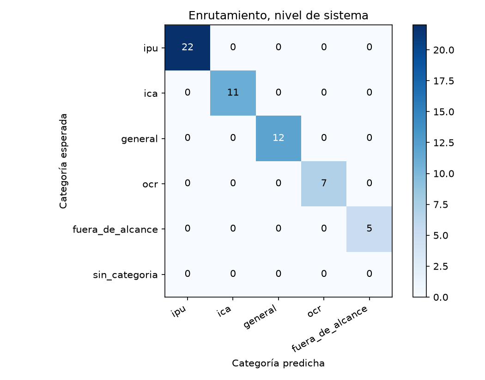
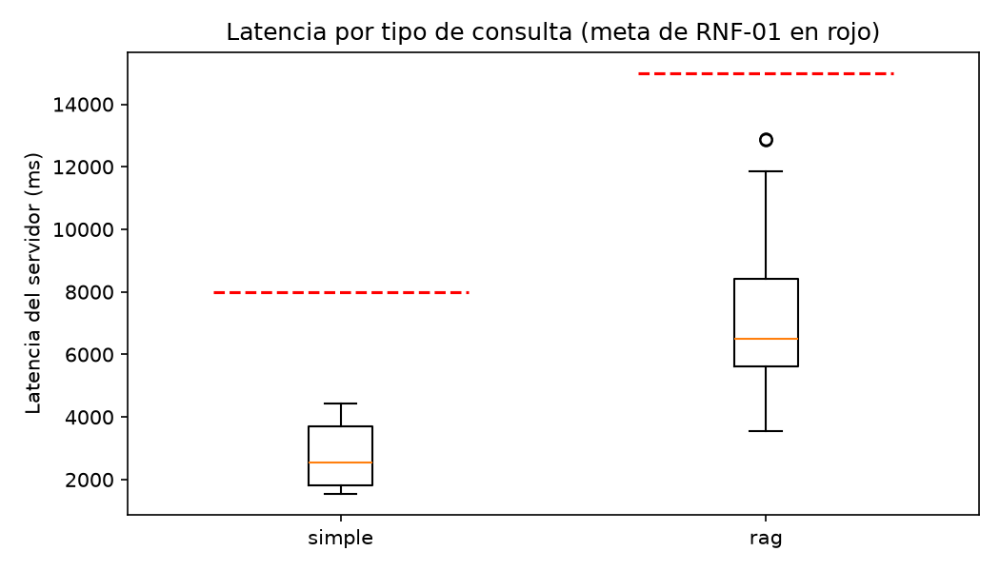

# Reporte de la corrida-2d

Generado por `scripts/evaluar.py` a partir de `resultados.jsonl` y `juez.jsonl`; no se edita a mano. Un escenario se supera si pasa todas las verificaciones de código y el juez lo califica correcta o parcialmente correcta, sin alucinación (sección 6.4). El intervalo de Wilson usa n = escenarios, porque los ensayos de un mismo escenario no son independientes (ADR-24).

Commit evaluado: `d3dab00`.

Huella del juez: `afecd5c1b4f62d52fc605ac6b350363cddee4604ae704f30247703146aa39805`.

## Escenarios del nivel de sistema

60 escenarios, 60 ensayos.

| Tasa | Valor | Wilson 95 % (n = escenarios) | Bootstrap 95 % |
|---|---|---|---|
| Meta (correcta o parcial, sin alucinación) | 91,7 % | 81,9 % a 96,4 % | 83,3 % a 98,3 % |
| Estricta | 75,0 % | 62,8 % a 84,2 % | 63,3 % a 85,0 % |

Verificaciones de código superadas: 95,0 %. Veredictos del juez: correcta, 45; parcialmente correcta, 13; incorrecta, 2. Con alucinación: 3,3 %; cita en 61,7 %, cita que sustenta en 60,0 %, cobertura completa en 76,7 % y claridad media de 4,67.

| Latencia | Turnos | p50 servidor | p95 servidor | p50 cliente | p95 cliente | Meta | Bajo la meta |
|---|---|---|---|---|---|---|---|
| simple | 18 | 2.547 | 4.424 | 2.579 | 4.570 | 8.000 | 18 |
| rag | 40 | 6.192 | 11.852 | 6.067 | 11.472 | 15.000 | 40 |

## R3 · Escenarios encadenados

3 escenarios, 3 ensayos.

| Tasa | Valor | Wilson 95 % (n = escenarios) | Bootstrap 95 % |
|---|---|---|---|
| Meta (correcta o parcial, sin alucinación) | 100,0 % | 43,9 % a 100,0 % | 100,0 % a 100,0 % |
| Estricta | 66,7 % | 20,8 % a 93,9 % | 0,0 % a 100,0 % |

Verificaciones de código superadas: 100,0 %. Veredictos del juez: correcta, 2; parcialmente correcta, 1; incorrecta, 0. Con alucinación: 0,0 %; cita en 100,0 %, cita que sustenta en 100,0 %, cobertura completa en 66,7 % y claridad media de 4,67.

| Latencia | Turnos | p50 servidor | p95 servidor | p50 cliente | p95 cliente | Meta | Bajo la meta |
|---|---|---|---|---|---|---|---|
| simple | 1 | 3.338 | 3.338 | 3.595 | 3.595 | 8.000 | 1 |
| rag | 7 | 7.373 | 9.191 | 7.056 | 8.814 | 15.000 | 7 |

## R4 · Seguridad

2 escenarios, 2 ensayos.

| Tasa | Valor | Wilson 95 % (n = escenarios) | Bootstrap 95 % |
|---|---|---|---|
| Meta (correcta o parcial, sin alucinación) | 100,0 % | 34,2 % a 100,0 % | 100,0 % a 100,0 % |
| Estricta | 100,0 % | 34,2 % a 100,0 % | 100,0 % a 100,0 % |

Verificaciones de código superadas: 100,0 %. Veredictos del juez: correcta, 2; parcialmente correcta, 0; incorrecta, 0. Con alucinación: 0,0 %; cita en 0,0 %, cita que sustenta en 0,0 %, cobertura completa en 100,0 % y claridad media de 5,00.

| Latencia | Turnos | p50 servidor | p95 servidor | p50 cliente | p95 cliente | Meta | Bajo la meta |
|---|---|---|---|---|---|---|---|
| simple | 2 | 2.352 | 2.556 | 2.354 | 2.541 | 8.000 | 2 |
| rag | 0 | — | — | — | — | 15.000 | 0 |

## Enrutamiento

### Nivel de sistema (primer turno)

| Categoría | Soporte | Precisión | Exhaustividad | F1 |
|---|---|---|---|---|
| ipu | 22 | 100,0 % | 100,0 % | 100,0 % |
| ica | 11 | 100,0 % | 100,0 % | 100,0 % |
| general | 12 | 100,0 % | 100,0 % | 100,0 % |
| ocr | 7 | 100,0 % | 100,0 % | 100,0 % |
| fuera_de_alcance | 5 | 100,0 % | 100,0 % | 100,0 % |

## Trazas (RNF-05)

1285 ejecuciones revisadas; 0 con identificadores de los usuarios de prueba.

