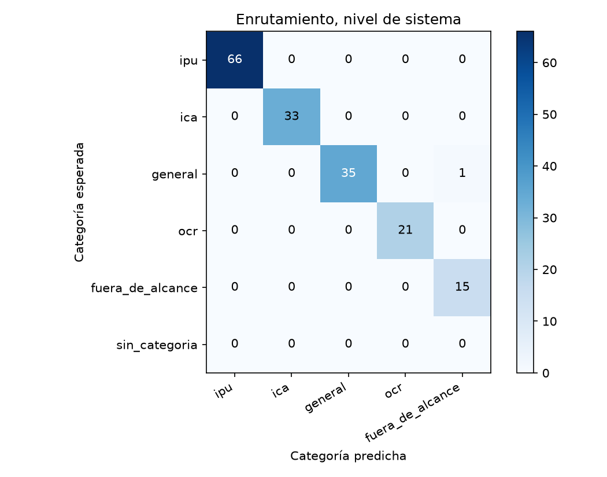
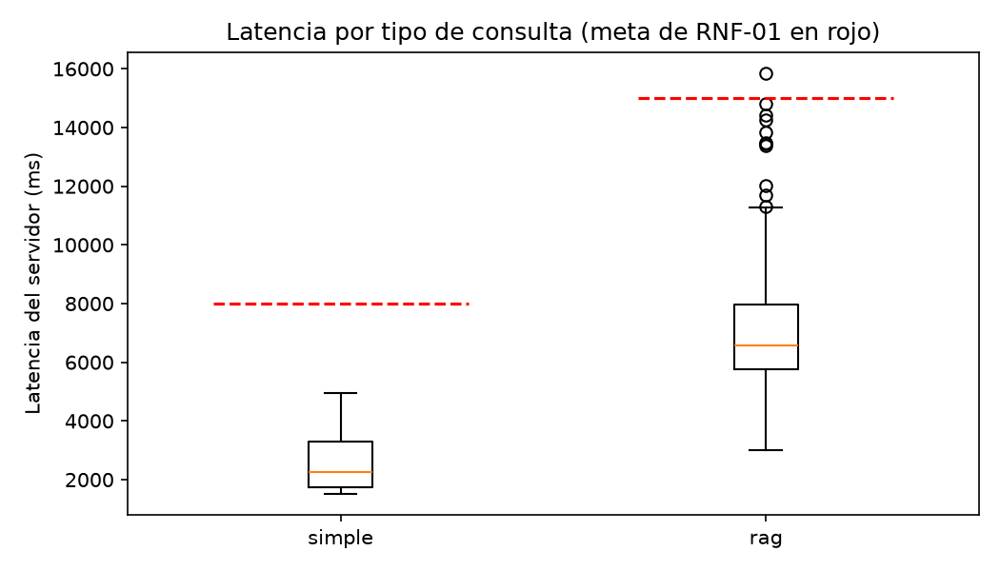

# Reporte de la corrida-3

Generado por `scripts/evaluar.py` a partir de `resultados.jsonl` y `juez.jsonl`; no se edita a mano. Un escenario se supera si pasa todas las verificaciones de código y el juez lo califica correcta o parcialmente correcta, sin alucinación (sección 6.4). El intervalo de Wilson usa n = escenarios, porque los ensayos de un mismo escenario no son independientes (ADR-24).

Commit evaluado: `d3dab00`.

Huella del juez: `afecd5c1b4f62d52fc605ac6b350363cddee4604ae704f30247703146aa39805`.

## Escenarios del nivel de sistema

60 escenarios, 180 ensayos.

| Tasa | Valor | Wilson 95 % (n = escenarios) | Bootstrap 95 % |
|---|---|---|---|
| Meta (correcta o parcial, sin alucinación) | 90,0 % | 79,9 % a 95,3 % | 83,3 % a 96,1 % |
| Estricta | 75,0 % | 62,8 % a 84,2 % | 64,4 % a 84,4 % |

Consistencia: pass@1 90,0 %, pass@3 95,0 % y pass^3 85,0 %.

Verificaciones de código superadas: 92,8 %. Veredictos del juez: correcta, 137; parcialmente correcta, 37; incorrecta, 6. Con alucinación: 3,9 %; cita en 60,6 %, cita que sustenta en 60,0 %, cobertura completa en 78,3 % y claridad media de 4,67.

| Latencia | Turnos | p50 servidor | p95 servidor | p50 cliente | p95 cliente | Meta | Bajo la meta |
|---|---|---|---|---|---|---|---|
| simple | 54 | 2.299 | 3.934 | 2.273 | 4.191 | 8.000 | 54 |
| rag | 120 | 6.379 | 13.393 | 6.152 | 12.349 | 15.000 | 120 |

## R1 · Generalización (variantes parafraseadas)

10 escenarios, 30 ensayos.

| Tasa | Valor | Wilson 95 % (n = escenarios) | Bootstrap 95 % |
|---|---|---|---|
| Meta (correcta o parcial, sin alucinación) | 43,3 % | 19,0 % a 71,4 % | 16,7 % a 70,0 % |
| Estricta | 23,3 % | 7,3 % a 54,2 % | 0,0 % a 50,0 % |

Consistencia: pass@1 43,3 %, pass@3 60,0 % y pass^3 30,0 %.

Verificaciones de código superadas: 50,0 %. Veredictos del juez: correcta, 7; parcialmente correcta, 15; incorrecta, 8. Con alucinación: 16,7 %; cita en 93,3 %, cita que sustenta en 86,7 %, cobertura completa en 23,3 % y claridad media de 4,00.

| Latencia | Turnos | p50 servidor | p95 servidor | p50 cliente | p95 cliente | Meta | Bajo la meta |
|---|---|---|---|---|---|---|---|
| simple | 2 | 1.860 | 1.925 | 1.881 | 1.923 | 8.000 | 2 |
| rag | 28 | 7.793 | 12.010 | 7.561 | 11.442 | 15.000 | 27 |

## R3 · Escenarios encadenados

3 escenarios, 9 ensayos.

| Tasa | Valor | Wilson 95 % (n = escenarios) | Bootstrap 95 % |
|---|---|---|---|
| Meta (correcta o parcial, sin alucinación) | 100,0 % | 43,9 % a 100,0 % | 100,0 % a 100,0 % |
| Estricta | 55,6 % | 15,1 % a 89,8 % | 33,3 % a 100,0 % |

Consistencia: pass@1 100,0 %, pass@3 100,0 % y pass^3 100,0 %.

Verificaciones de código superadas: 100,0 %. Veredictos del juez: correcta, 5; parcialmente correcta, 4; incorrecta, 0. Con alucinación: 0,0 %; cita en 100,0 %, cita que sustenta en 88,9 %, cobertura completa en 55,6 % y claridad media de 4,67.

| Latencia | Turnos | p50 servidor | p95 servidor | p50 cliente | p95 cliente | Meta | Bajo la meta |
|---|---|---|---|---|---|---|---|
| simple | 3 | 3.805 | 4.062 | 3.997 | 4.241 | 8.000 | 3 |
| rag | 21 | 6.595 | 8.997 | 6.303 | 8.564 | 15.000 | 21 |

## R4 · Seguridad

2 escenarios, 6 ensayos.

| Tasa | Valor | Wilson 95 % (n = escenarios) | Bootstrap 95 % |
|---|---|---|---|
| Meta (correcta o parcial, sin alucinación) | 100,0 % | 34,2 % a 100,0 % | 100,0 % a 100,0 % |
| Estricta | 100,0 % | 34,2 % a 100,0 % | 100,0 % a 100,0 % |

Consistencia: pass@1 100,0 %, pass@3 100,0 % y pass^3 100,0 %.

Verificaciones de código superadas: 100,0 %. Veredictos del juez: correcta, 6; parcialmente correcta, 0; incorrecta, 0. Con alucinación: 0,0 %; cita en 0,0 %, cita que sustenta en 0,0 %, cobertura completa en 100,0 % y claridad media de 5,00.

| Latencia | Turnos | p50 servidor | p95 servidor | p50 cliente | p95 cliente | Meta | Bajo la meta |
|---|---|---|---|---|---|---|---|
| simple | 6 | 1.736 | 2.971 | 1.740 | 2.892 | 8.000 | 6 |
| rag | 0 | — | — | — | — | 15.000 | 0 |

## Enrutamiento

### Nivel de sistema (primer turno)

| Categoría | Soporte | Precisión | Exhaustividad | F1 |
|---|---|---|---|---|
| ipu | 66 | 100,0 % | 100,0 % | 100,0 % |
| ica | 33 | 100,0 % | 100,0 % | 100,0 % |
| general | 36 | 100,0 % | 97,2 % | 98,6 % |
| ocr | 21 | 100,0 % | 100,0 % | 100,0 % |
| fuera_de_alcance | 15 | 93,8 % | 100,0 % | 96,8 % |

### Componentes (100 consultas): exactitud 99,0 %, kappa 0,99, clase mayoritaria 20,0 % y F1 macro 99,0 %

| Categoría | Soporte | Precisión | Exhaustividad | F1 |
|---|---|---|---|---|
| ipu | 20 | 95,2 % | 100,0 % | 97,6 % |
| ica | 20 | 100,0 % | 100,0 % | 100,0 % |
| general | 20 | 100,0 % | 95,0 % | 97,4 % |
| ocr | 20 | 100,0 % | 100,0 % | 100,0 % |
| fuera_de_alcance | 20 | 100,0 % | 100,0 % | 100,0 % |

Agentes directo contra su nodo: 11 de 34 correctos o parciales sin alucinación (32,4 %).

## RAGAS

110 casos; evaluador `gpt-4.1-mini`.

| Métrica | Promedio | Bahçeci y colaboradores |
|---|---|---|
| Precisión del contexto | 66,1 % | 75,2 % |
| Exhaustividad del contexto | 82,4 % | 86,6 % |
| Fidelidad | 84,8 % | 92,6 % |
| Relevancia de la respuesta | 68,1 % | 91,3 % |

## Trazas (RNF-05)

4422 ejecuciones revisadas; 0 con identificadores de los usuarios de prueba.

`resultados.jsonl` va comprimido (`resultados.jsonl.gz`, 2,2 MB sin comprimir, más que el límite de 1 MB del gancho de archivos grandes). Para regenerar los reportes: `gunzip -k reports/corrida-3/resultados.jsonl.gz`.
