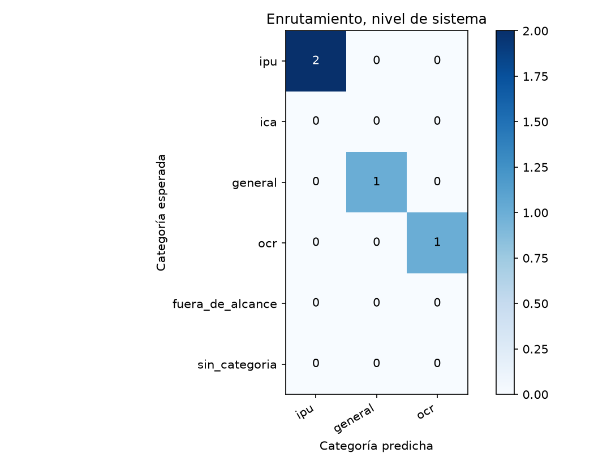
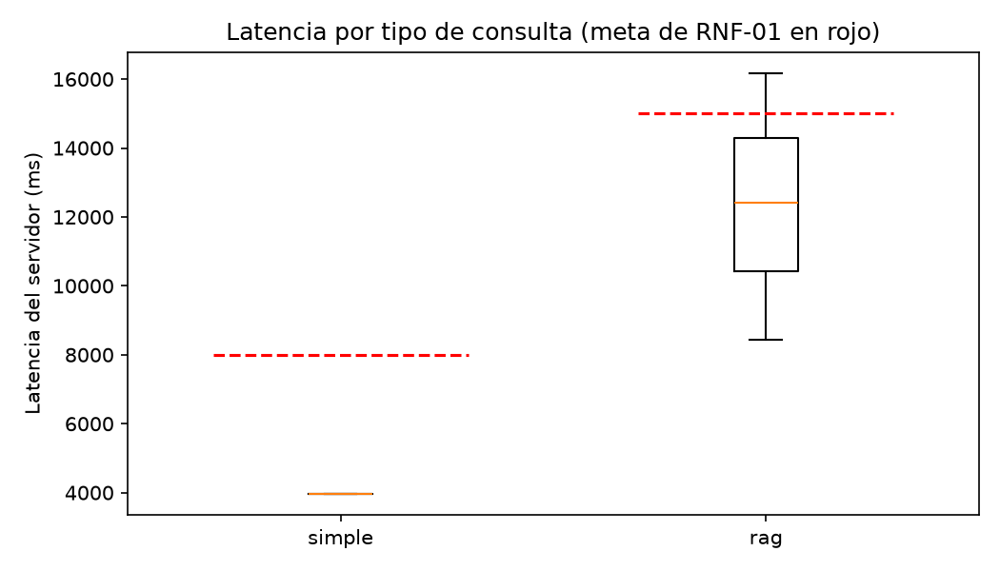

# Reporte de la mini-corrida

Generado por `scripts/evaluar.py` a partir de `resultados.jsonl` y `juez.jsonl`; no se edita a mano. Un escenario se supera si pasa todas las verificaciones de código y el juez lo califica correcta o parcialmente correcta, sin alucinación (sección 6.4). El intervalo de Wilson usa n = escenarios, porque los ensayos de un mismo escenario no son independientes (ADR-24).

Huella del juez: `925788b38ffe143521296c3ef892742b84e024893e0b95a53f4f7a59ca8ed170`.

## Escenarios del nivel de sistema

5 escenarios, 5 ensayos.

| Tasa | Valor | Wilson 95 % (n = escenarios) | Bootstrap 95 % |
|---|---|---|---|
| Meta (correcta o parcial, sin alucinación) | 60,0 % | 23,1 % a 88,2 % | 20,0 % a 100,0 % |
| Estricta | 40,0 % | 11,8 % a 76,9 % | 0,0 % a 80,0 % |

Verificaciones de código superadas: 80,0 %. Veredictos del juez: correcta, 2; parcialmente correcta, 2; incorrecta, 1. Con alucinación: 20,0 %; cita en 40,0 %, cita que sustenta en 40,0 %, cobertura completa en 40,0 % y claridad media de 4,40.

| Latencia | Turnos | p50 servidor | p95 servidor | p50 cliente | p95 cliente | Meta | Bajo la meta |
|---|---|---|---|---|---|---|---|
| simple | 1 | 3.955 | 3.955 | 7.586 | 7.586 | 8.000 | 1 |
| rag | 3 | 12.422 | 16.178 | 12.429 | 16.186 | 15.000 | 2 |

## Enrutamiento

### Nivel de sistema (primer turno)

| Categoría | Soporte | Precisión | Exhaustividad | F1 |
|---|---|---|---|---|
| ipu | 2 | 100,0 % | 100,0 % | 100,0 % |
| general | 1 | 100,0 % | 100,0 % | 100,0 % |
| ocr | 1 | 100,0 % | 100,0 % | 100,0 % |

## RAGAS

2 casos; evaluador `gpt-4.1-mini`.

| Métrica | Promedio | Bahçeci y colaboradores |
|---|---|---|
| Precisión del contexto | 93,3 % | 75,2 % |
| Exhaustividad del contexto | 66,7 % | 86,6 % |
| Fidelidad | 72,8 % | 92,6 % |
| Relevancia de la respuesta | 81,2 % | 91,3 % |

