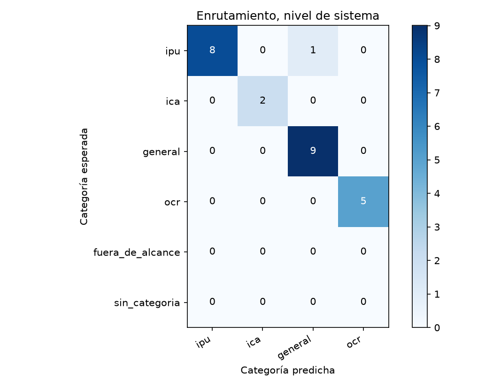
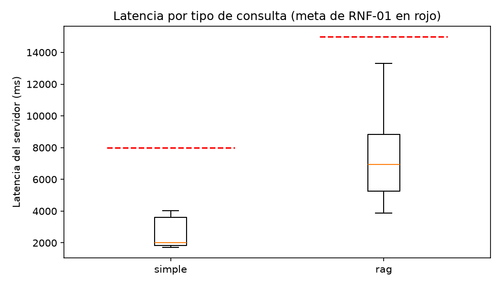

# Reporte de la regresion-correcciones-corrida-1

Generado por `scripts/evaluar.py` a partir de `resultados.jsonl` y `juez.jsonl`; no se edita a mano. Un escenario se supera si pasa todas las verificaciones de código y el juez lo califica correcta o parcialmente correcta, sin alucinación (sección 6.4). El intervalo de Wilson usa n = escenarios, porque los ensayos de un mismo escenario no son independientes (ADR-24).

Commit evaluado: `—`.

Huella del juez: `afecd5c1b4f62d52fc605ac6b350363cddee4604ae704f30247703146aa39805`.

## Escenarios del nivel de sistema

28 escenarios, 28 ensayos.

| Tasa | Valor | Wilson 95 % (n = escenarios) | Bootstrap 95 % |
|---|---|---|---|
| Meta (correcta o parcial, sin alucinación) | 89,3 % | 72,8 % a 96,3 % | 75,0 % a 100,0 % |
| Estricta | 67,9 % | 49,3 % a 82,1 % | 50,0 % a 85,7 % |

Verificaciones de código superadas: 92,9 %. Veredictos del juez: correcta, 19; parcialmente correcta, 8; incorrecta, 1. Con alucinación: 3,6 %; cita en 50,0 %, cita que sustenta en 50,0 %, cobertura completa en 71,4 % y claridad media de 4,79.

| Latencia | Turnos | p50 servidor | p95 servidor | p50 cliente | p95 cliente | Meta | Bajo la meta |
|---|---|---|---|---|---|---|---|
| simple | 10 | 1.963 | 4.040 | 1.993 | 4.052 | 8.000 | 10 |
| rag | 15 | 6.954 | 13.297 | 6.965 | 13.306 | 15.000 | 15 |

## Enrutamiento

### Nivel de sistema (primer turno)

| Categoría | Soporte | Precisión | Exhaustividad | F1 |
|---|---|---|---|---|
| ipu | 9 | 100,0 % | 88,9 % | 94,1 % |
| ica | 2 | 100,0 % | 100,0 % | 100,0 % |
| general | 9 | 90,0 % | 100,0 % | 94,7 % |
| ocr | 5 | 100,0 % | 100,0 % | 100,0 % |

