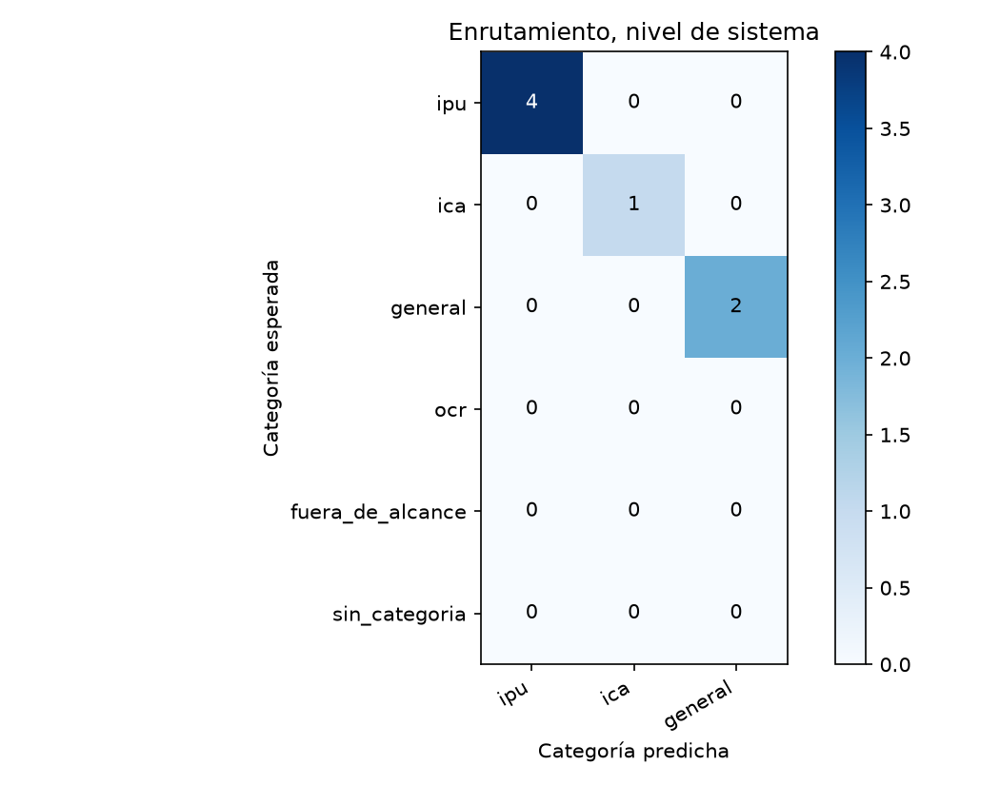
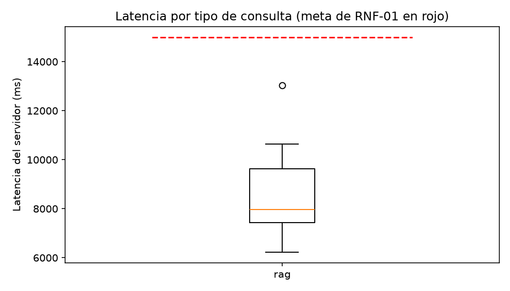

# Reporte de la verif-fix-busqueda

Generado por `scripts/evaluar.py` a partir de `resultados.jsonl` y `juez.jsonl`; no se edita a mano. Un escenario se supera si pasa todas las verificaciones de código y el juez lo califica correcta o parcialmente correcta, sin alucinación (sección 6.4). El intervalo de Wilson usa n = escenarios, porque los ensayos de un mismo escenario no son independientes (ADR-24).

Commit evaluado: `—`.

Huella del juez: `afecd5c1b4f62d52fc605ac6b350363cddee4604ae704f30247703146aa39805`.

## Escenarios del nivel de sistema

7 escenarios, 7 ensayos.

| Tasa | Valor | Wilson 95 % (n = escenarios) | Bootstrap 95 % |
|---|---|---|---|
| Meta (correcta o parcial, sin alucinación) | 71,4 % | 35,9 % a 91,8 % | 42,9 % a 100,0 % |
| Estricta | 28,6 % | 8,2 % a 64,1 % | 0,0 % a 57,1 % |

Verificaciones de código superadas: 71,4 %. Veredictos del juez: correcta, 2; parcialmente correcta, 3; incorrecta, 2. Con alucinación: 0,0 %; cita en 85,7 %, cita que sustenta en 85,7 %, cobertura completa en 28,6 % y claridad media de 4,00.

| Latencia | Turnos | p50 servidor | p95 servidor | p50 cliente | p95 cliente | Meta | Bajo la meta |
|---|---|---|---|---|---|---|---|
| simple | 0 | — | — | — | — | 8.000 | 0 |
| rag | 7 | 7.968 | 13.038 | 7.977 | 13.045 | 15.000 | 7 |

## Enrutamiento

### Nivel de sistema (primer turno)

| Categoría | Soporte | Precisión | Exhaustividad | F1 |
|---|---|---|---|---|
| ipu | 4 | 100,0 % | 100,0 % | 100,0 % |
| ica | 1 | 100,0 % | 100,0 % | 100,0 % |
| general | 2 | 100,0 % | 100,0 % | 100,0 % |

