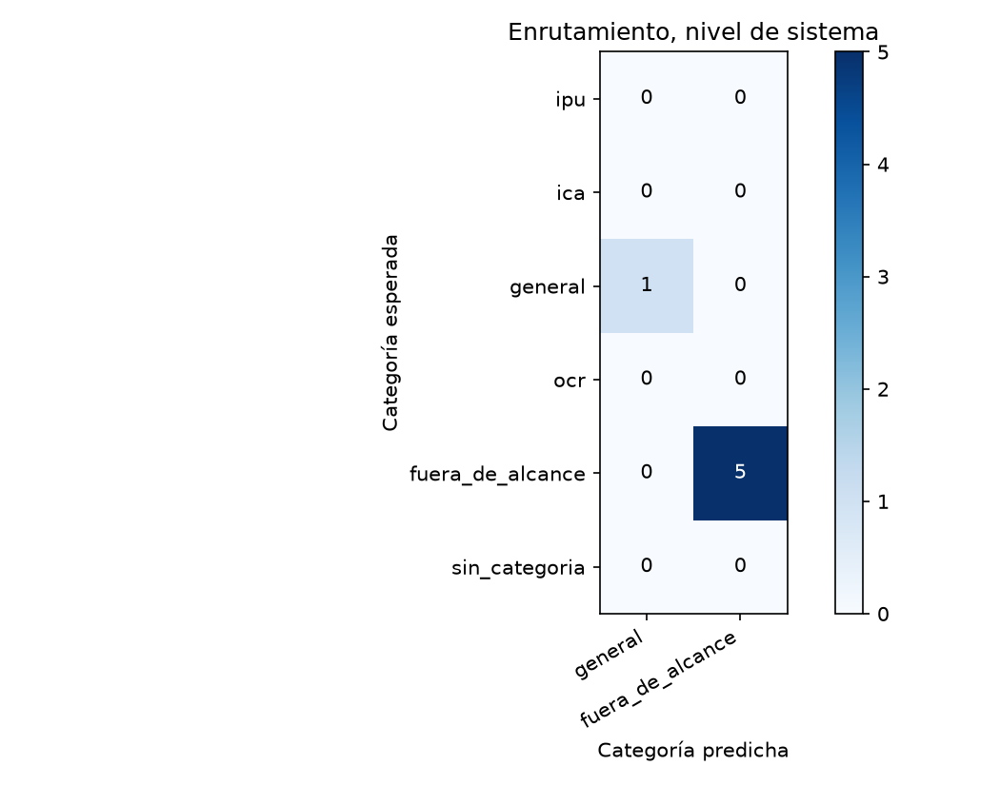
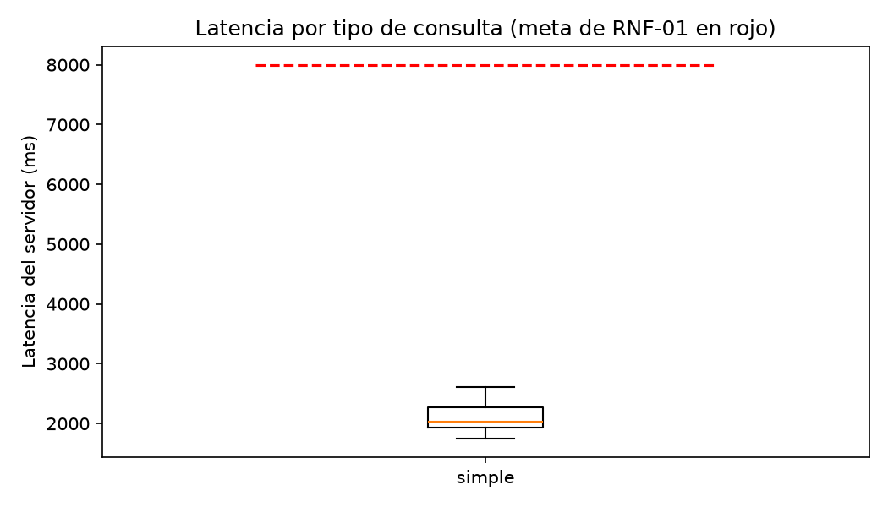

# Reporte de la verif-fix-categoria-clasificada

Generado por `scripts/evaluar.py` a partir de `resultados.jsonl` y `juez.jsonl`; no se edita a mano. Un escenario se supera si pasa todas las verificaciones de código y el juez lo califica correcta o parcialmente correcta, sin alucinación (sección 6.4). El intervalo de Wilson usa n = escenarios, porque los ensayos de un mismo escenario no son independientes (ADR-24).

Commit evaluado: `—`.

Huella del juez: `6b4c54e5aedaeab684d2071b9bb8d817640a5f27aec43f3563e0a1fa681dbc10`.

## Escenarios del nivel de sistema

6 escenarios, 6 ensayos.

| Tasa | Valor | Wilson 95 % (n = escenarios) | Bootstrap 95 % |
|---|---|---|---|
| Meta (correcta o parcial, sin alucinación) | 100,0 % | 61,0 % a 100,0 % | 100,0 % a 100,0 % |
| Estricta | 66,7 % | 30,0 % a 90,3 % | 33,3 % a 100,0 % |

Verificaciones de código superadas: 100,0 %. Veredictos del juez: correcta, 4; parcialmente correcta, 2; incorrecta, 0. Con alucinación: 0,0 %; cita en 0,0 %, cita que sustenta en 0,0 %, cobertura completa en 66,7 % y claridad media de 5,00.

| Latencia | Turnos | p50 servidor | p95 servidor | p50 cliente | p95 cliente | Meta | Bajo la meta |
|---|---|---|---|---|---|---|---|
| simple | 6 | 1.998 | 2.616 | 2.014 | 2.644 | 8.000 | 6 |
| rag | 0 | — | — | — | — | 15.000 | 0 |

## Enrutamiento

### Nivel de sistema (primer turno)

| Categoría | Soporte | Precisión | Exhaustividad | F1 |
|---|---|---|---|---|
| general | 1 | 100,0 % | 100,0 % | 100,0 % |
| fuera_de_alcance | 5 | 100,0 % | 100,0 % | 100,0 % |

