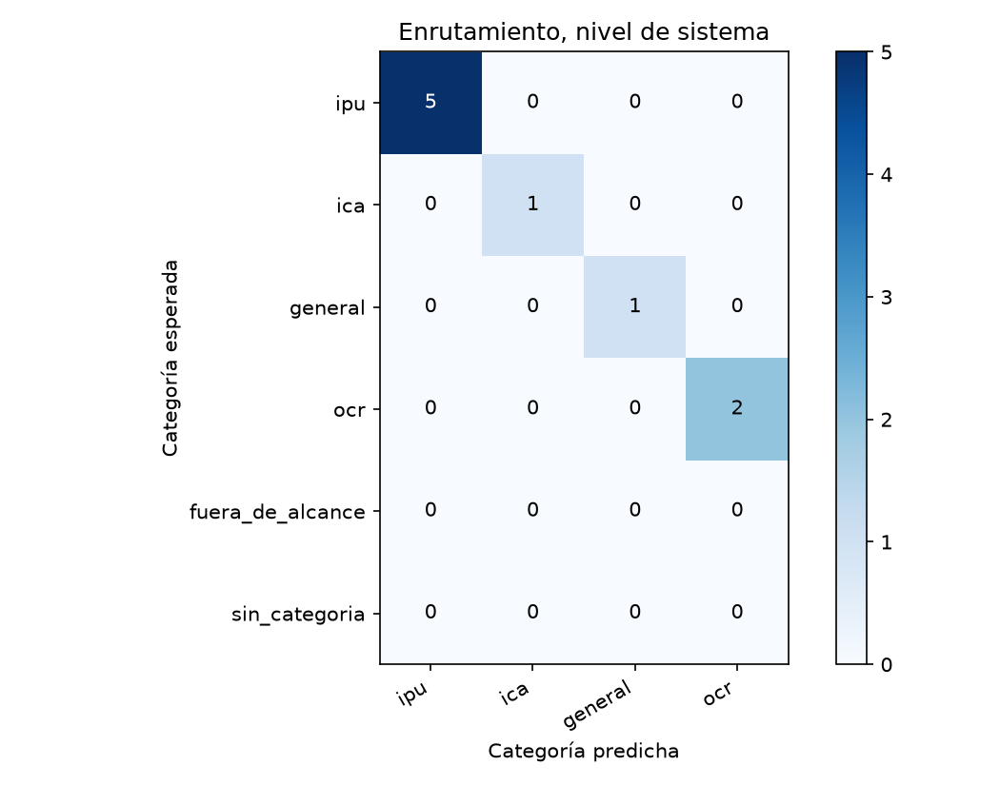
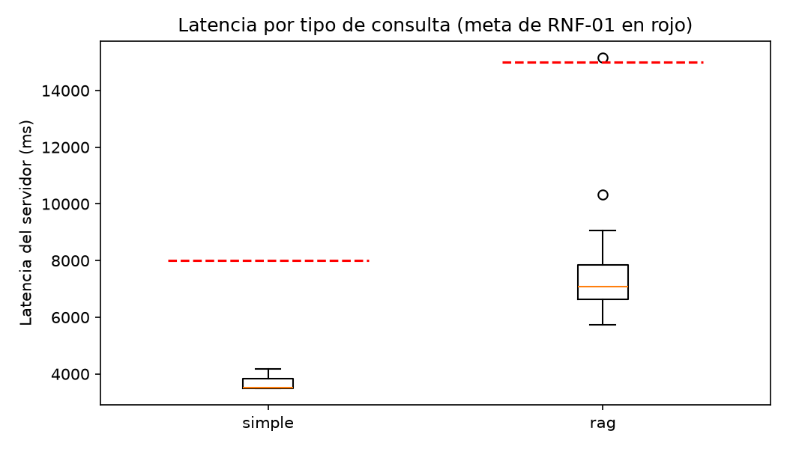

# Reporte de la verif-fix-instrumento

Generado por `scripts/evaluar.py` a partir de `resultados.jsonl` y `juez.jsonl`; no se edita a mano. Un escenario se supera si pasa todas las verificaciones de código y el juez lo califica correcta o parcialmente correcta, sin alucinación (sección 6.4). El intervalo de Wilson usa n = escenarios, porque los ensayos de un mismo escenario no son independientes (ADR-24).

Commit evaluado: `—`.

Huella del juez: `ca531fb5163067e165910d974a834fb1c9acc38c60f554119f95bbdfa81e5873`.

## Escenarios del nivel de sistema

9 escenarios, 9 ensayos.

| Tasa | Valor | Wilson 95 % (n = escenarios) | Bootstrap 95 % |
|---|---|---|---|
| Meta (correcta o parcial, sin alucinación) | 88,9 % | 56,5 % a 98,0 % | 66,7 % a 100,0 % |
| Estricta | 77,8 % | 45,3 % a 93,7 % | 44,4 % a 100,0 % |

Verificaciones de código superadas: 100,0 %. Veredictos del juez: correcta, 7; parcialmente correcta, 2; incorrecta, 0. Con alucinación: 11,1 %; cita en 88,9 %, cita que sustenta en 77,8 %, cobertura completa en 88,9 % y claridad media de 4,11.

| Latencia | Turnos | p50 servidor | p95 servidor | p50 cliente | p95 cliente | Meta | Bajo la meta |
|---|---|---|---|---|---|---|---|
| simple | 2 | 3.484 | 4.181 | 3.508 | 4.203 | 8.000 | 2 |
| rag | 8 | 7.222 | 15.169 | 7.236 | 15.190 | 15.000 | 7 |

## R3 · Escenarios encadenados

2 escenarios, 2 ensayos.

| Tasa | Valor | Wilson 95 % (n = escenarios) | Bootstrap 95 % |
|---|---|---|---|
| Meta (correcta o parcial, sin alucinación) | 100,0 % | 34,2 % a 100,0 % | 100,0 % a 100,0 % |
| Estricta | 50,0 % | 9,5 % a 90,5 % | 0,0 % a 100,0 % |

Verificaciones de código superadas: 100,0 %. Veredictos del juez: correcta, 1; parcialmente correcta, 1; incorrecta, 0. Con alucinación: 0,0 %; cita en 100,0 %, cita que sustenta en 100,0 %, cobertura completa en 50,0 % y claridad media de 4,00.

| Latencia | Turnos | p50 servidor | p95 servidor | p50 cliente | p95 cliente | Meta | Bajo la meta |
|---|---|---|---|---|---|---|---|
| simple | 1 | 3.507 | 3.507 | 3.526 | 3.526 | 8.000 | 1 |
| rag | 4 | 6.465 | 6.770 | 6.481 | 6.784 | 15.000 | 4 |

## Enrutamiento

### Nivel de sistema (primer turno)

| Categoría | Soporte | Precisión | Exhaustividad | F1 |
|---|---|---|---|---|
| ipu | 5 | 100,0 % | 100,0 % | 100,0 % |
| ica | 1 | 100,0 % | 100,0 % | 100,0 % |
| general | 1 | 100,0 % | 100,0 % | 100,0 % |
| ocr | 2 | 100,0 % | 100,0 % | 100,0 % |

