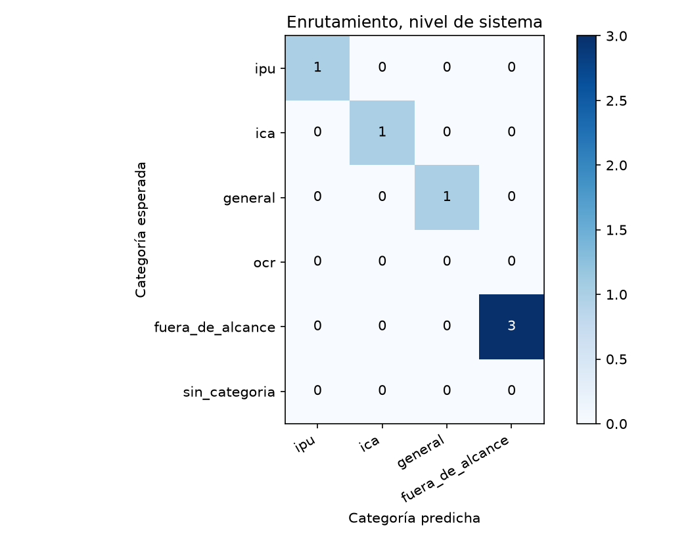
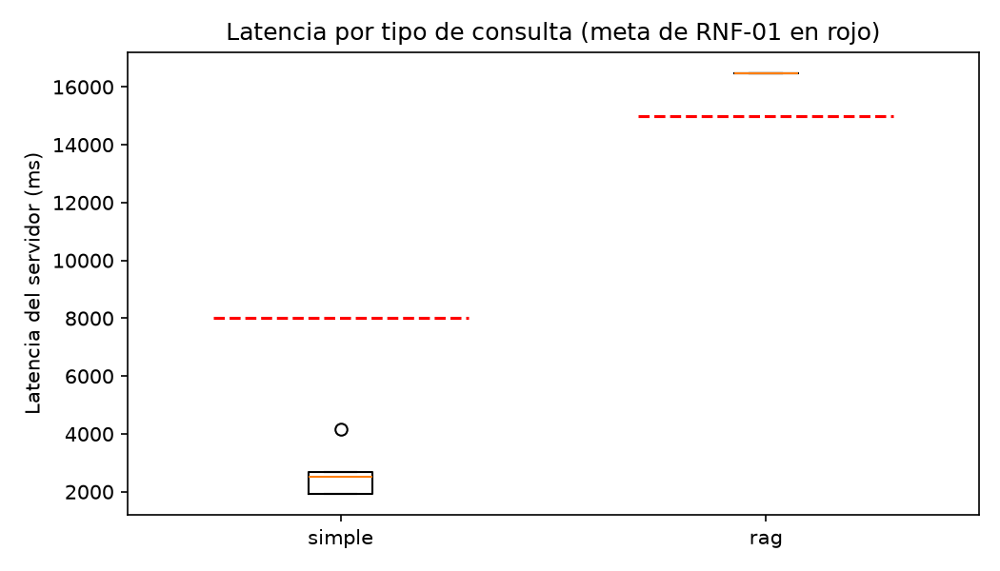

# Reporte de la verif-mensaje-escalamiento-2

Generado por `scripts/evaluar.py` a partir de `resultados.jsonl` y `juez.jsonl`; no se edita a mano. Un escenario se supera si pasa todas las verificaciones de código y el juez lo califica correcta o parcialmente correcta, sin alucinación (sección 6.4). El intervalo de Wilson usa n = escenarios, porque los ensayos de un mismo escenario no son independientes (ADR-24).

Commit evaluado: `—`.

Huella del juez: `afecd5c1b4f62d52fc605ac6b350363cddee4604ae704f30247703146aa39805`.

## Escenarios del nivel de sistema

7 escenarios, 7 ensayos.

| Tasa | Valor | Wilson 95 % (n = escenarios) | Bootstrap 95 % |
|---|---|---|---|
| Meta (correcta o parcial, sin alucinación) | 100,0 % | 64,6 % a 100,0 % | 100,0 % a 100,0 % |
| Estricta | 100,0 % | 64,6 % a 100,0 % | 100,0 % a 100,0 % |

Verificaciones de código superadas: 100,0 %. Veredictos del juez: correcta, 7; parcialmente correcta, 0; incorrecta, 0. Con alucinación: 0,0 %; cita en 0,0 %, cita que sustenta en 0,0 %, cobertura completa en 100,0 % y claridad media de 5,00.

| Latencia | Turnos | p50 servidor | p95 servidor | p50 cliente | p95 cliente | Meta | Bajo la meta |
|---|---|---|---|---|---|---|---|
| simple | 5 | 2.535 | 4.152 | 2.543 | 4.161 | 8.000 | 5 |
| rag | 1 | 16.484 | 16.484 | 16.491 | 16.491 | 15.000 | 0 |

## Enrutamiento

### Nivel de sistema (primer turno)

| Categoría | Soporte | Precisión | Exhaustividad | F1 |
|---|---|---|---|---|
| ipu | 1 | 100,0 % | 100,0 % | 100,0 % |
| ica | 1 | 100,0 % | 100,0 % | 100,0 % |
| general | 1 | 100,0 % | 100,0 % | 100,0 % |
| fuera_de_alcance | 3 | 100,0 % | 100,0 % | 100,0 % |

