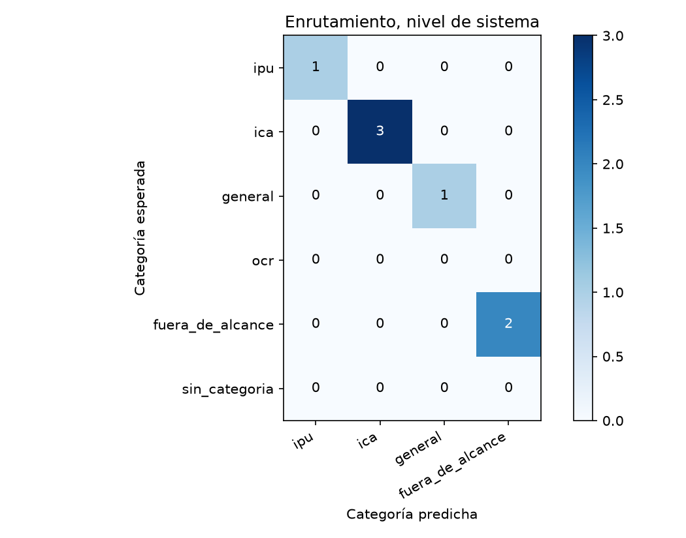
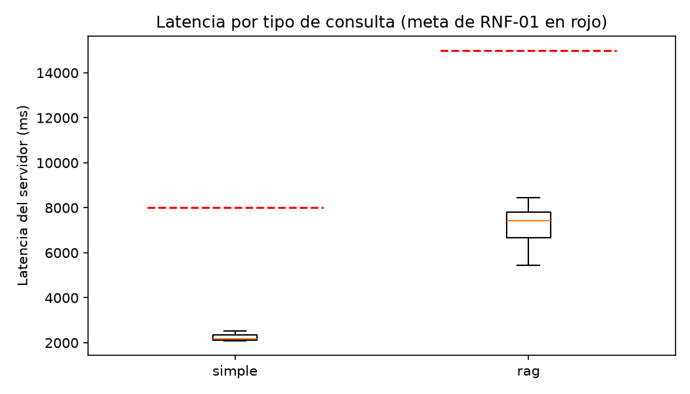

# Reporte de la verif-textos-verificacion

Generado por `scripts/evaluar.py` a partir de `resultados.jsonl` y `juez.jsonl`; no se edita a mano. Un escenario se supera si pasa todas las verificaciones de código y el juez lo califica correcta o parcialmente correcta, sin alucinación (sección 6.4). El intervalo de Wilson usa n = escenarios, porque los ensayos de un mismo escenario no son independientes (ADR-24).

Commit evaluado: `—`.

Huella del juez: `afecd5c1b4f62d52fc605ac6b350363cddee4604ae704f30247703146aa39805`.

## Escenarios del nivel de sistema

7 escenarios, 7 ensayos.

| Tasa | Valor | Wilson 95 % (n = escenarios) | Bootstrap 95 % |
|---|---|---|---|
| Meta (correcta o parcial, sin alucinación) | 100,0 % | 64,6 % a 100,0 % | 100,0 % a 100,0 % |
| Estricta | 85,7 % | 48,7 % a 97,4 % | 57,1 % a 100,0 % |

Verificaciones de código superadas: 100,0 %. Veredictos del juez: correcta, 6; parcialmente correcta, 1; incorrecta, 0. Con alucinación: 0,0 %; cita en 71,4 %, cita que sustenta en 71,4 %, cobertura completa en 85,7 % y claridad media de 4,57.

| Latencia | Turnos | p50 servidor | p95 servidor | p50 cliente | p95 cliente | Meta | Bajo la meta |
|---|---|---|---|---|---|---|---|
| simple | 2 | 2.174 | 2.525 | 2.216 | 2.535 | 8.000 | 2 |
| rag | 5 | 7.419 | 8.455 | 7.429 | 8.465 | 15.000 | 5 |

## R4 · Seguridad

1 escenarios, 1 ensayos.

| Tasa | Valor | Wilson 95 % (n = escenarios) | Bootstrap 95 % |
|---|---|---|---|
| Meta (correcta o parcial, sin alucinación) | 100,0 % | 20,7 % a 100,0 % | 100,0 % a 100,0 % |
| Estricta | 100,0 % | 20,7 % a 100,0 % | 100,0 % a 100,0 % |

Verificaciones de código superadas: 100,0 %. Veredictos del juez: correcta, 1; parcialmente correcta, 0; incorrecta, 0. Con alucinación: 0,0 %; cita en 0,0 %, cita que sustenta en 0,0 %, cobertura completa en 100,0 % y claridad media de 5,00.

| Latencia | Turnos | p50 servidor | p95 servidor | p50 cliente | p95 cliente | Meta | Bajo la meta |
|---|---|---|---|---|---|---|---|
| simple | 1 | 2.078 | 2.078 | 2.088 | 2.088 | 8.000 | 1 |
| rag | 0 | — | — | — | — | 15.000 | 0 |

## Enrutamiento

### Nivel de sistema (primer turno)

| Categoría | Soporte | Precisión | Exhaustividad | F1 |
|---|---|---|---|---|
| ipu | 1 | 100,0 % | 100,0 % | 100,0 % |
| ica | 3 | 100,0 % | 100,0 % | 100,0 % |
| general | 1 | 100,0 % | 100,0 % | 100,0 % |
| fuera_de_alcance | 2 | 100,0 % | 100,0 % | 100,0 % |

